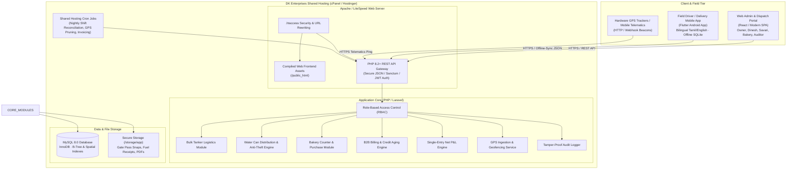

# DK Track — System Architecture & Shared Hosting Blueprint

## 1. Executive Summary & System Philosophy

**DK Track** is a dedicated, single-tenant ERP and logistics management platform engineered specifically for **DK Enterprises**. It seamlessly unifies three ground-level business operations onto a centralized database and administrative control plane:
1. **Bulk Water Tanker Fleet Logistics** (9KL, 16KL, 24KL fleet dispatch, trip sheets, driver batta, fuel & gate passes).
2. **Water Can Distribution & Anti-Theft Control** (Tata Ace delivery routes, 60–70 morning bottling plant intake, can-for-can reconciliation, field collections, shift-end cash surrender).
3. **Bakery & Retail Store Operations** (Daily 10-item raw material purchasing log, 3-minute evening counter cash + UPI reconciliation, vendor payables).

Cross-cutting capabilities include:
- **Corporate B2B Automated Invoicing & Credit Aging Engine** (Amirtha Milk, The Chennai Silks, textile mills; 15-day / monthly cycles, rate slabs, 0–60+ days credit tracking).
- **Single-Entry Net P&L Engine & Auditor IT Export** (Vehicle-level profitability, division-wise P&L, 1-click auditor export formatted for partnership tax filing).
- **Real-Time Fleet & GPS Vehicle Tracking** (Live vehicle status, route playback, geofencing, driver trip verification).
- **Dedicated Field Servant / Driver Mobile Application** (Ultra-fast, low-literacy bilingual Tamil/English interface, offline SQLite caching).

---

## 2. Standalone Single-Tenant Philosophy

Unlike SaaS platforms that force multiple businesses into a generic multi-tenant architecture with shared tables, complex tenant IDs, and compromising customizations:
- **Exclusively Built for DK Enterprises**: The codebase, database schema, operational workflows, and security models are 100% tailored to DK Enterprises' physical ground reality.
- **Data Sovereignty**: All customer lists, corporate contracts, pricing slabs, vehicle financials, and audit logs reside in DK Enterprises' private database.
- **Zero SaaS Bloat**: No multi-tenant middleware, tenant data isolation risks, or unnecessary cross-tenant abstraction layers.
- **Complete Code & Intellectual Property Ownership**: Fully portable, modular, and hostable on DK Enterprises' designated servers.

---

## 3. Shared Hosting Deployment Strategy

DK Enterprises specifically requires compatibility with standard **Shared Hosting environments** (e.g., Hostinger, cPanel, LiteSpeed/Apache Linux shared servers) to minimize operational infrastructure expenses while ensuring top-tier security, reliability, and speed.

### 3.1 Shared Hosting Constraints & Solutions

| Shared Hosting Constraint | Engineering Solution in DK Track |
| :--- | :--- |
| **No Persistent Node.js/Daemon Process** | Web frontend is built as a static Single Page Application (React/TypeScript or Vue) compiled into HTML/JS/CSS bundles served directly by Apache/LiteSpeed. |
| **No Docker / Containerization** | Native modern PHP 8.2+ backend utilizing Laravel 11/12 or modular REST API framework running within standard Apache `public_html`. |
| **Execution Time & Memory Limits** | Lightweight request-response cycles (<100ms API latency). Heavy jobs (batch invoicing, PDF generation, tax export) are chunked or processed on-demand with pagination. |
| **No Background Redis/Queue Workers** | Background tasks (daily invoice generation, GPS data pruning, audit integrity checks) execute via standard cPanel/Hostinger **Cron Jobs** invoking PHP CLI commands (`php artisan schedule:run` or dedicated cron endpoints). |
| **Directory Isolation (`public_html`)** | Strict two-tier directory separation: core application files reside outside the web root (or secured via `.htaccess`), and only compiled public assets and `index.php` reside in `public_html`. |
| **Shared MySQL Server** | Highly indexed relational schema, normalized operational tables, and scheduled pruning/aggregation of high-volume GPS telemetry points to prevent database bloat. |

---

## 4. High-Level System Architecture Diagram



---

## 5. Technology Stack Specifications

### 5.1 Backend REST API
- **Language & Runtime**: PHP 8.2+ / 8.4 (NTS 64-bit).
- **Core Framework**: Laravel 11.x / 12.x configured in API-only / modular mode.
- **Authentication**: Laravel Sanctum with cryptographically signed Personal Access Tokens and expiration policies.
- **Security Middleware**:
  - Strict CORS restriction (explicitly allowed origins).
  - Rate limiting (e.g., 60 requests/minute for standard users, 120/minute for GPS ingestion).
  - SQL Injection prevention via mandatory Eloquent ORM / PDO prepared statements.
  - Strict Input Request Validation (preventing mass assignment vulnerabilities).
  - MIME-type verification and EXIF-stripping on uploaded camera images.

### 5.2 Web Management Portal (Frontend)
- **Framework**: Modern Single Page Application (React 18/19 with TypeScript or Vue 3) bundled with Vite.
- **Styling**: Vanilla CSS / modern design tokens with rich visual aesthetics, responsive breakpoints (Desktop, Tablet, Mobile browser), high contrast, dark/light theme support.
- **Mapping & Fleet Visualization**: Leaflet.js with OpenStreetMap tiles (100% free, zero Google Maps API monthly recurring cost on shared hosting, with fallback Google Maps API support).
- **Export Engines**: Client-side / PHP Excel generation (`PhpSpreadsheet`) for Auditor tax schedules, and streamable PDF invoice generation (`dompdf` / `TCPDF` optimized for low memory usage).

### 5.3 Mobile Application (Field Operations)
- **Framework**: Flutter (Dart) compiled to native Android APK.
- **Localization**: Bilingual engine (English & Tamil — தமிழ்) with instant toggle on every screen.
- **Local Persistence & Offline Sync**: SQLite (`sqflite`) for full offline route completion; transactions queue locally and sync automatically when internet connectivity resumes.
- **Camera & Proof of Delivery**: Native camera integration with auto-compression (compressing 8MB camera snaps to ~200KB before upload to save hosting bandwidth and storage).
- **Telematics**: Background location service logging periodic GPS coordinates with battery-efficient geofencing.

### 5.4 Database Tier
- **Engine**: MySQL 8.0+ / MariaDB 10.6+ on InnoDB storage engine.
- **Character Set**: `utf8mb4` with `utf8mb4_unicode_ci` collation (supporting Tamil Unicode characters natively).
- **Integrity**: Strict foreign key constraints with indexed foreign keys; transactional ACID compliance for all financial movements.

---

## 6. Directory Structure for Shared Hosting

To guarantee both maximum security and compatibility with standard cPanel / Hostinger directory configurations, the project is structured as follows:

```
/home/dkenterprises/                <-- Root account directory (above web root)
├── dk-track-core/                  <-- Core PHP application & business logic
│   ├── app/
│   │   ├── Http/Controllers/
│   │   │   ├── Api/V1/
│   │   │   │   ├── AuthController.php
│   │   │   │   ├── TankerDispatchController.php
│   │   │   │   ├── WaterCanController.php
│   │   │   │   ├── BakeryController.php
│   │   │   │   ├── B2BBillingController.php
│   │   │   │   ├── FleetTrackingController.php
│   │   │   │   └── PnLController.php
│   │   ├── Models/
│   │   └── Services/
│   ├── config/
│   ├── database/
│   │   ├── migrations/
│   │   └── seeders/
│   ├── routes/
│   │   └── api.php
│   ├── storage/                    <-- Private uploaded gate pass & fuel photos
│   └── .env                        <-- Private environment secrets
│
└── public_html/                    <-- Public web root exposed to Internet
    ├── .htaccess                   <-- Security rules, MIME types, gzip & rewrite
    ├── index.php                   <-- Entry point loading core from ../dk-track-core
    ├── assets/                     <-- Compiled Web App JS, CSS, fonts, SVG icons
    ├── app-release.apk             <-- Direct download link for driver Android app
    └── uploads/                    <-- Public sanitized thumbnails (if allowed)
```

---

## 7. Performance & Scalability Guardrails

1. **Optimized Payloads**: All API responses use compact JSON formats with ISO-8601 timestamps and pagination (default 25 records per page).
2. **Aggressive Image Optimization**: Mobile field app resizes and compresses captured receipts and gate pass images to under 250KB before transmission.
3. **GPS Telematics Downsampling**: High-frequency GPS pings are retained at high resolution for 30 days, then downsampled into daily mileage and stop summaries, preventing shared hosting storage degradation.
4. **Static Caching**: Web App UI assets utilize long-term immutable caching headers (`Cache-Control: public, max-age=31536000`), ensuring instantaneous page loads on office desktop computers.
