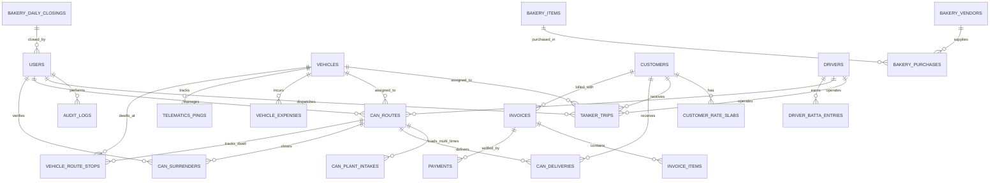

# DK Track — Database Schema & Data Models Specification

## 1. Schema Philosophy & Shared Hosting Design Rules

1. **Storage Engine**: `InnoDB` for all operational and financial tables to guarantee ACID transactions, row-level locking, and foreign key referential integrity.
2. **Character Set & Collation**: `utf8mb4` with `utf8mb4_unicode_ci` across all text and name columns to support Tamil (தமிழ்) script and English seamlessly.
3. **Primary Keys**: Unsigned `BIGINT` with auto-increment (`id`) for performance and join indexing on MySQL shared hosting.
4. **Precision Decimal Types**: All monetary values (`amount`, `rate`, `balance`, `cash_collected`, `fuel_cost`) must use `DECIMAL(12, 2)`. Quantities and capacities (`litres`, `cans`, `kilolitres`) must use `DECIMAL(10, 2)` or `INT UNSIGNED`. **Floating point (`FLOAT`/`DOUBLE`) is strictly forbidden for financial calculations.**
5. **Soft Deletion & Auditability**: Critical master data and financial entries use `deleted_at` timestamps (`softDeletes`) to prevent accidental deletion and preserve audit integrity.
6. **Future POS & ERP Integration Readiness**: All master and transactional entities include `external_pos_id` and `idempotency_key` columns for zero-disruption integration with retail POS and accounting software.

---

## 2. Entity Relationship Overview



---

## 3. Detailed Data DDL & Model Specifications

### 3.1 Authentication, Roles & Audit

#### `users`
System operators across the company (Owner, Dinesh, Savari, Bakery family, Drivers, Auditor).
```sql
CREATE TABLE users (
    id BIGINT UNSIGNED AUTO_INCREMENT PRIMARY KEY,
    name VARCHAR(150) NOT NULL,
    phone VARCHAR(20) NOT NULL UNIQUE,
    email VARCHAR(191) NULL UNIQUE,
    password_hash VARCHAR(255) NOT NULL,
    role ENUM('owner', 'tanker_manager', 'can_manager', 'bakery_manager', 'driver', 'auditor') NOT NULL,
    division_access ENUM('all', 'tanker', 'can', 'bakery') DEFAULT 'all',
    preferred_language ENUM('en', 'ta') DEFAULT 'ta',
    is_active BOOLEAN DEFAULT TRUE,
    last_login_at TIMESTAMP NULL,
    created_at TIMESTAMP NULL,
    updated_at TIMESTAMP NULL,
    deleted_at TIMESTAMP NULL,
    INDEX idx_user_role (role),
    INDEX idx_user_phone (phone)
) ENGINE=InnoDB DEFAULT CHARSET=utf8mb4 COLLATE=utf8mb4_unicode_ci;
```

#### `audit_logs`
Tamper-evident system activity ledger recording all state changes, price modifications, and cash entries.
```sql
CREATE TABLE audit_logs (
    id BIGINT UNSIGNED AUTO_INCREMENT PRIMARY KEY,
    user_id BIGINT UNSIGNED NULL,
    action VARCHAR(100) NOT NULL, -- 'trip_approved', 'cash_surrendered', 'surcharge_added'
    entity_type VARCHAR(100) NOT NULL, -- 'tanker_trips', 'can_surrenders', 'can_deliveries'
    entity_id BIGINT UNSIGNED NOT NULL,
    old_values JSON NULL,
    new_values JSON NULL,
    ip_address VARCHAR(45) NULL,
    user_agent VARCHAR(255) NULL,
    created_at TIMESTAMP DEFAULT CURRENT_TIMESTAMP,
    FOREIGN KEY (user_id) REFERENCES users(id) ON DELETE SET NULL,
    INDEX idx_audit_entity (entity_type, entity_id),
    INDEX idx_audit_created (created_at)
) ENGINE=InnoDB DEFAULT CHARSET=utf8mb4 COLLATE=utf8mb4_unicode_ci;
```

---

### 3.2 Master Fleet & Dynamic Surcharges (Zero-Hardcoding)

#### `vehicles`
Open, fully customizable tanker capacities (e.g., 9KL, 16KL, 24KL, 30KL, 40KL) and can trucks.
```sql
CREATE TABLE vehicles (
    id BIGINT UNSIGNED AUTO_INCREMENT PRIMARY KEY,
    vehicle_number VARCHAR(30) NOT NULL UNIQUE, -- e.g., 'TN 34 AF 4954'
    vehicle_type ENUM('tanker', 'can_truck', 'other') NOT NULL,
    capacity_kl DECIMAL(6, 2) NULL, -- Completely open! Supports 40.00, 28.00, 9.00, 16.00 etc.
    capacity_cans INT UNSIGNED NULL, -- e.g., 70 for Tata Ace
    ownership_type ENUM('owned', 'leased', 'attached') DEFAULT 'owned',
    gps_device_id VARCHAR(100) NULL, -- Device token or mobile UUID
    is_active BOOLEAN DEFAULT TRUE,
    created_at TIMESTAMP NULL,
    updated_at TIMESTAMP NULL,
    deleted_at TIMESTAMP NULL,
    INDEX idx_vehicle_type (vehicle_type)
) ENGINE=InnoDB DEFAULT CHARSET=utf8mb4 COLLATE=utf8mb4_unicode_ci;
```

#### `trip_surcharge_types`
Configurable operational add-ons (motor pump fee, waiting detention, long distance, tolls).
```sql
CREATE TABLE trip_surcharge_types (
    id BIGINT UNSIGNED AUTO_INCREMENT PRIMARY KEY,
    code VARCHAR(50) NOT NULL UNIQUE, -- 'motor_usage', 'waiting_time', 'long_distance', 'toll', 'misc'
    name_en VARCHAR(100) NOT NULL,
    name_ta VARCHAR(100) NOT NULL, -- தமிழ்: 'மோட்டார் பயன்பாடு', 'காத்திருப்பு கட்டணம்'
    billing_type ENUM('flat', 'per_hour', 'per_km', 'manual') NOT NULL,
    default_rate DECIMAL(10, 2) DEFAULT 0.00,
    is_taxable BOOLEAN DEFAULT FALSE,
    is_active BOOLEAN DEFAULT TRUE,
    created_at TIMESTAMP NULL,
    updated_at TIMESTAMP NULL
) ENGINE=InnoDB DEFAULT CHARSET=utf8mb4 COLLATE=utf8mb4_unicode_ci;
```

#### `customers`
Corporate clients (Texvalley, Amirtha Milk, The Chennai Silks, Mills) and retail can distribution outlets.
```sql
CREATE TABLE customers (
    id BIGINT UNSIGNED AUTO_INCREMENT PRIMARY KEY,
    company_name VARCHAR(200) NOT NULL,
    customer_code VARCHAR(50) NULL UNIQUE,
    contact_person VARCHAR(150) NULL,
    phone VARCHAR(20) NOT NULL,
    gstin VARCHAR(20) NULL,
    billing_address TEXT NULL,
    delivery_location_lat DECIMAL(10, 7) NULL,
    delivery_location_lng DECIMAL(10, 7) NULL,
    geofence_radius_meters INT UNSIGNED DEFAULT 250,
    division_type ENUM('tanker', 'can', 'both') NOT NULL,
    billing_cycle ENUM('daily', 'weekly', '15_days', 'monthly_1_to_30', 'monthly_custom') DEFAULT 'monthly_1_to_30',
    credit_limit DECIMAL(12, 2) DEFAULT 0.00,
    credit_days_allowed INT UNSIGNED DEFAULT 30,
    current_credit_balance DECIMAL(12, 2) DEFAULT 0.00,
    external_pos_id VARCHAR(100) NULL, -- POS / External ERP link
    is_active BOOLEAN DEFAULT TRUE,
    created_at TIMESTAMP NULL,
    updated_at TIMESTAMP NULL,
    INDEX idx_customer_div (division_type),
    INDEX idx_customer_balance (current_credit_balance)
) ENGINE=InnoDB DEFAULT CHARSET=utf8mb4 COLLATE=utf8mb4_unicode_ci;
```

#### `customer_rate_slabs`
Dynamic pricing engine per customer per vehicle capacity / product.
```sql
CREATE TABLE customer_rate_slabs (
    id BIGINT UNSIGNED AUTO_INCREMENT PRIMARY KEY,
    customer_id BIGINT UNSIGNED NOT NULL,
    service_type ENUM('tanker_trip', 'can_delivery', 'special_water') NOT NULL,
    capacity_kl DECIMAL(6, 2) NULL, -- e.g., 9.00, 16.00, 24.00, 40.00
    price_per_load DECIMAL(10, 2) NOT NULL,
    price_per_kl DECIMAL(10, 2) NULL,
    can_sale_rate DECIMAL(8, 2) NULL, -- e.g., 20.00 or 30.00 per can
    can_deposit_rate DECIMAL(8, 2) NULL, -- e.g., 150.00 per new can
    gst_rate_percent DECIMAL(5, 2) DEFAULT 0.00, -- 0.00% drinking water vs 18.00% vehicle hire
    motor_charge_override DECIMAL(10, 2) NULL, -- Customer-specific motor pump charge
    waiting_hour_rate_override DECIMAL(10, 2) NULL, -- Customer-specific waiting fee
    effective_from DATE NOT NULL,
    effective_to DATE NULL,
    created_at TIMESTAMP NULL,
    updated_at TIMESTAMP NULL,
    FOREIGN KEY (customer_id) REFERENCES customers(id) ON DELETE CASCADE,
    INDEX idx_slab_lookup (customer_id, service_type, capacity_kl)
) ENGINE=InnoDB DEFAULT CHARSET=utf8mb4 COLLATE=utf8mb4_unicode_ci;
```

---

### 3.3 Bulk Water Tanker Fleet Logistics (With Dynamic Surcharges)

#### `tanker_trips`
Digital trip sheet with itemized surcharges (motor usage, waiting time, long distance, toll, misc).
```sql
CREATE TABLE tanker_trips (
    id BIGINT UNSIGNED AUTO_INCREMENT PRIMARY KEY,
    trip_number VARCHAR(50) NOT NULL UNIQUE, -- e.g., 'TRP-2026-00842'
    customer_id BIGINT UNSIGNED NOT NULL,
    vehicle_id BIGINT UNSIGNED NOT NULL,
    driver_id BIGINT UNSIGNED NOT NULL,
    dispatched_by_user_id BIGINT UNSIGNED NOT NULL,
    
    trip_date DATE NOT NULL,
    capacity_kl DECIMAL(6, 2) NOT NULL, -- e.g., 40.00, 24.00, 16.00, 9.00
    load_source VARCHAR(150) NOT NULL DEFAULT 'Main RO Water Plant',
    destination_site VARCHAR(255) NOT NULL,
    
    status ENUM('scheduled', 'dispatched', 'in_transit', 'at_destination', 'unloading', 'completed', 'cancelled') DEFAULT 'scheduled',
    
    odometer_start INT UNSIGNED NULL,
    odometer_end INT UNSIGNED NULL,
    total_km INT UNSIGNED GENERATED ALWAYS AS (odometer_end - odometer_start) STORED,
    
    start_time DATETIME NULL,
    arrival_time DATETIME NULL,
    unloading_start_time DATETIME NULL,
    delivery_time DATETIME NULL,
    end_time DATETIME NULL,
    
    -- Ground Surcharges & Extra Charges Engine
    trip_fare DECIMAL(10, 2) NOT NULL, -- Base load fare
    motor_used BOOLEAN DEFAULT FALSE,
    motor_charges DECIMAL(10, 2) DEFAULT 0.00,
    waiting_time_hours DECIMAL(4, 2) DEFAULT 0.00,
    waiting_time_charges DECIMAL(10, 2) DEFAULT 0.00,
    long_distance_km INT UNSIGNED DEFAULT 0,
    long_distance_surcharge DECIMAL(10, 2) DEFAULT 0.00,
    miscellaneous_charges DECIMAL(10, 2) DEFAULT 0.00,
    miscellaneous_description VARCHAR(255) NULL,
    
    total_surcharges DECIMAL(10, 2) GENERATED ALWAYS AS (
        motor_charges + waiting_time_charges + long_distance_surcharge + miscellaneous_charges
    ) STORED,
    total_billing_amount DECIMAL(10, 2) GENERATED ALWAYS AS (
        trip_fare + motor_charges + waiting_time_charges + long_distance_surcharge + miscellaneous_charges
    ) STORED,
    
    driver_batta DECIMAL(8, 2) DEFAULT 0.00,
    total_expenses DECIMAL(10, 2) DEFAULT 0.00,
    net_trip_profit DECIMAL(10, 2) GENERATED ALWAYS AS (
        (trip_fare + motor_charges + waiting_time_charges + long_distance_surcharge + miscellaneous_charges) - (driver_batta + total_expenses)
    ) STORED,
    
    gate_pass_photo_path VARCHAR(255) NULL,
    receiver_signature_path VARCHAR(255) NULL,
    receiver_name VARCHAR(150) NULL,
    receiver_phone VARCHAR(20) NULL,
    
    invoice_id BIGINT UNSIGNED NULL,
    is_invoiced BOOLEAN DEFAULT FALSE,
    notes TEXT NULL,
    idempotency_key VARCHAR(100) NULL UNIQUE,
    
    created_at TIMESTAMP NULL,
    updated_at TIMESTAMP NULL,
    FOREIGN KEY (customer_id) REFERENCES customers(id),
    FOREIGN KEY (vehicle_id) REFERENCES vehicles(id),
    FOREIGN KEY (driver_id) REFERENCES drivers(id),
    FOREIGN KEY (dispatched_by_user_id) REFERENCES users(id),
    INDEX idx_trip_date (trip_date),
    INDEX idx_trip_status (status),
    INDEX idx_trip_customer (customer_id, is_invoiced)
) ENGINE=InnoDB DEFAULT CHARSET=utf8mb4 COLLATE=utf8mb4_unicode_ci;
```

---

### 3.4 Water Can Distribution (Multi-Plant Intakes & GPS-Tracked Deliveries)

#### `can_routes`
Daily distribution shift for Tata Ace truck supporting multiple plant refills.
```sql
CREATE TABLE can_routes (
    id BIGINT UNSIGNED AUTO_INCREMENT PRIMARY KEY,
    route_date DATE NOT NULL,
    vehicle_id BIGINT UNSIGNED NOT NULL,
    driver_id BIGINT UNSIGNED NOT NULL,
    helper_name VARCHAR(100) NULL,
    route_name VARCHAR(150) NOT NULL, -- e.g., 'Race Course - Gandhipuram Route'
    status ENUM('active', 'surrendered', 'closed') DEFAULT 'active',
    
    total_loaded_cans INT UNSIGNED NOT NULL DEFAULT 0, -- Sum of all plant intakes (e.g. 72 + 84 + 57 = 213)
    total_delivered_cans INT UNSIGNED DEFAULT 0, -- e.g. 188
    total_empty_cans_returned INT UNSIGNED DEFAULT 0, -- e.g. 188
    total_damaged_cans INT UNSIGNED DEFAULT 0,
    current_truck_stock INT UNSIGNED GENERATED ALWAYS AS (total_loaded_cans - total_delivered_cans) STORED, -- e.g. 25
    
    total_cash_sales DECIMAL(10, 2) DEFAULT 0.00, -- e.g. ₹1,810
    total_upi_sales DECIMAL(10, 2) DEFAULT 0.00,
    total_credit_sales DECIMAL(10, 2) DEFAULT 0.00, -- e.g. ₹1,960
    total_sales_value DECIMAL(10, 2) GENERATED ALWAYS AS (total_cash_sales + total_upi_sales + total_credit_sales) STORED, -- e.g. ₹3,770
    
    total_plant_intake_cost DECIMAL(10, 2) DEFAULT 0.00, -- e.g. 213 × ₹8 = ₹1,704
    total_distance_km DECIMAL(6, 2) DEFAULT 0.00, -- e.g. 72.0 km
    driver_wage_cost DECIMAL(10, 2) DEFAULT 1000.00,
    
    shift_start_time DATETIME NULL,
    shift_end_time DATETIME NULL,
    created_at TIMESTAMP NULL,
    updated_at TIMESTAMP NULL,
    FOREIGN KEY (vehicle_id) REFERENCES vehicles(id),
    FOREIGN KEY (driver_id) REFERENCES drivers(id),
    INDEX idx_can_route_date (route_date, status)
) ENGINE=InnoDB DEFAULT CHARSET=utf8mb4 COLLATE=utf8mb4_unicode_ci;
```

#### `can_plant_intakes`
Supports 2, 3, or more plant refills throughout the day (*Image 3*).
```sql
CREATE TABLE can_plant_intakes (
    id BIGINT UNSIGNED AUTO_INCREMENT PRIMARY KEY,
    can_route_id BIGINT UNSIGNED NOT NULL,
    intake_sequence INT UNSIGNED NOT NULL DEFAULT 1, -- Load 1, Load 2, Load 3...
    plant_slip_number VARCHAR(50) NULL,
    cans_loaded INT UNSIGNED NOT NULL, -- e.g., 72, 84, 57
    purchase_rate_per_can DECIMAL(8, 2) NOT NULL DEFAULT 8.00, -- Plant rate ₹8
    total_cost DECIMAL(10, 2) GENERATED ALWAYS AS (cans_loaded * purchase_rate_per_can) STORED,
    plant_operator_name VARCHAR(100) NULL,
    slip_photo_path VARCHAR(255) NULL,
    loaded_at DATETIME NOT NULL,
    created_at TIMESTAMP NULL,
    updated_at TIMESTAMP NULL,
    FOREIGN KEY (can_route_id) REFERENCES can_routes(id) ON DELETE CASCADE,
    INDEX idx_intake_route (can_route_id, intake_sequence)
) ENGINE=InnoDB DEFAULT CHARSET=utf8mb4 COLLATE=utf8mb4_unicode_ci;
```

#### `can_deliveries`
Timestamped, GPS-verified customer drop with on-the-spot payment tracking.
```sql
CREATE TABLE can_deliveries (
    id BIGINT UNSIGNED AUTO_INCREMENT PRIMARY KEY,
    can_route_id BIGINT UNSIGNED NOT NULL,
    customer_id BIGINT UNSIGNED NOT NULL,
    cans_delivered INT UNSIGNED NOT NULL,
    empty_cans_collected INT UNSIGNED NOT NULL DEFAULT 0,
    rate_per_can DECIMAL(8, 2) NOT NULL, -- e.g. 20.00
    total_amount DECIMAL(10, 2) GENERATED ALWAYS AS (cans_delivered * rate_per_can) STORED,
    
    payment_mode ENUM('cash', 'upi', 'credit') NOT NULL,
    amount_paid DECIMAL(10, 2) NOT NULL DEFAULT 0.00,
    unpaid_balance DECIMAL(10, 2) GENERATED ALWAYS AS (total_amount - amount_paid) STORED,
    payment_time DATETIME NOT NULL, -- Precise on-the-spot payment timestamp
    payment_reference VARCHAR(100) NULL, -- UPI transaction ID if GPay/PhonePe
    
    delivery_lat DECIMAL(10, 7) NOT NULL, -- On-the-spot GPS coordinates
    delivery_lng DECIMAL(10, 7) NOT NULL,
    distance_from_previous_stop_km DECIMAL(6, 2) DEFAULT 0.00,
    
    client_uuid VARCHAR(100) NULL UNIQUE, -- Offline idempotency UUID
    notes VARCHAR(255) NULL,
    created_at TIMESTAMP NULL,
    updated_at TIMESTAMP NULL,
    FOREIGN KEY (can_route_id) REFERENCES can_routes(id) ON DELETE CASCADE,
    FOREIGN KEY (customer_id) REFERENCES customers(id),
    INDEX idx_delivery_cust (customer_id, payment_time)
) ENGINE=InnoDB DEFAULT CHARSET=utf8mb4 COLLATE=utf8mb4_unicode_ci;
```

---

### 3.5 Delivery Route Intelligence & Stoppage / Dwell Analysis

#### `vehicle_route_stops`
Tracks every place the delivery agent stopped, rest time, customer dwell time, and idling.
```sql
CREATE TABLE vehicle_route_stops (
    id BIGINT UNSIGNED AUTO_INCREMENT PRIMARY KEY,
    vehicle_id BIGINT UNSIGNED NOT NULL,
    can_route_id BIGINT UNSIGNED NULL,
    tanker_trip_id BIGINT UNSIGNED NULL,
    
    latitude DECIMAL(10, 7) NOT NULL,
    longitude DECIMAL(10, 7) NOT NULL,
    location_label VARCHAR(150) NULL, -- e.g., 'Aran Cafe - 1', 'Main RO Plant', 'Tea Stall'
    customer_id BIGINT UNSIGNED NULL,
    
    arrival_time DATETIME NOT NULL,
    departure_time DATETIME NULL,
    dwell_duration_minutes INT UNSIGNED DEFAULT 0,
    
    stop_category ENUM('customer_delivery', 'plant_loading', 'fuel_station', 'rest_break', 'traffic_halt', 'unauthorized_idle') NOT NULL,
    ignition_status ENUM('engine_on_idling', 'engine_off') DEFAULT 'engine_off',
    
    created_at TIMESTAMP DEFAULT CURRENT_TIMESTAMP,
    FOREIGN KEY (vehicle_id) REFERENCES vehicles(id) ON DELETE CASCADE,
    FOREIGN KEY (can_route_id) REFERENCES can_routes(id) ON DELETE CASCADE,
    INDEX idx_stop_vehicle_time (vehicle_id, arrival_time)
) ENGINE=InnoDB DEFAULT CHARSET=utf8mb4 COLLATE=utf8mb4_unicode_ci;
```

---

### 3.6 Future POS & External ERP Integration Gateway

#### `integration_webhooks`
Enables external Bakery POS machines, barcode scanners, and accounting packages to sync seamlessly.
```sql
CREATE TABLE integration_webhooks (
    id BIGINT UNSIGNED AUTO_INCREMENT PRIMARY KEY,
    target_system VARCHAR(100) NOT NULL, -- e.g., 'Bakery_Android_POS', 'Tally_Sync', 'Zoho'
    event_type VARCHAR(100) NOT NULL, -- e.g., 'bakery.sale_synced', 'invoice.created'
    payload JSON NOT NULL,
    status ENUM('pending', 'delivered', 'failed') DEFAULT 'pending',
    retry_count INT UNSIGNED DEFAULT 0,
    response_code INT UNSIGNED NULL,
    response_body TEXT NULL,
    created_at TIMESTAMP DEFAULT CURRENT_TIMESTAMP,
    INDEX idx_webhook_status (status)
) ENGINE=InnoDB DEFAULT CHARSET=utf8mb4 COLLATE=utf8mb4_unicode_ci;
```
