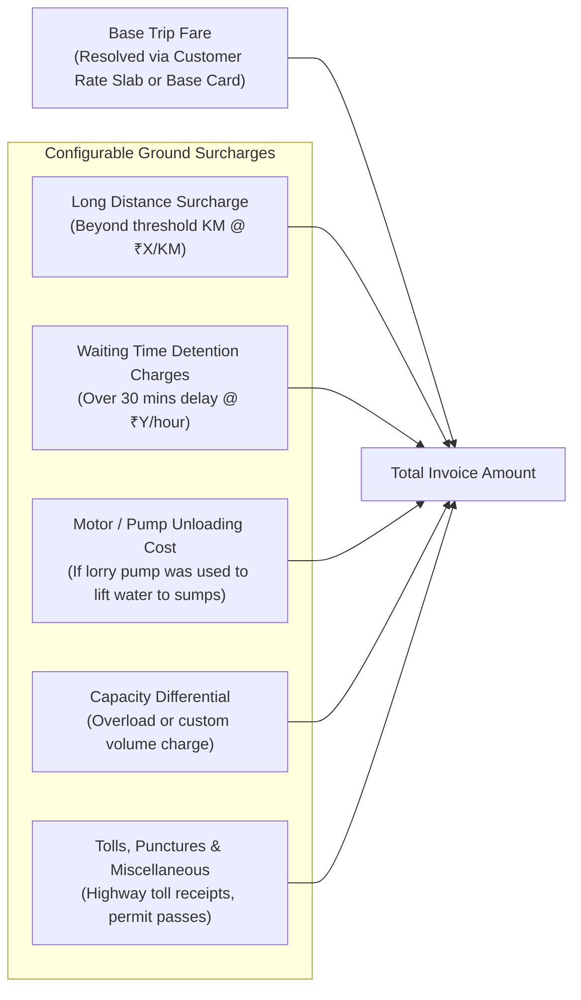
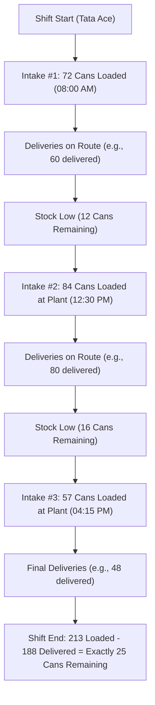

# DK Track — Customization & Zero-Hardcoding Engine Specification

## 1. The Zero-Hardcoding Law for DK Track

> **MANDATORY RULE FOR ALL AI AGENTS & DEVELOPERS:**
> No business entity, pricing figure, vehicle capacity, tax rate, customer name, route name, or operational threshold may EVER be hardcoded in backend PHP source code, SQL queries, frontend JavaScript/TypeScript components, or mobile Flutter/Dart widgets.
>
> Everything must originate from the database, environment configuration, or dynamic system settings tables.

---

## 2. Dynamic Vehicle & Tanker Capacity Architecture

### 2.1 Infinite Capacity Flexibility (e.g., 40KL, 28KL, 12.5KL)
Tanker capacities are **NEVER** restricted to hardcoded enums or fixed dropdown values (such as just 9KL, 16KL, 24KL).
- If DK Enterprises rents or buys a **40KL trailer tanker**, a **12KL medium truck**, or a **28KL articulated lorry**, the system must accept and manage it seamlessly.
- **Database Type**: `DECIMAL(6, 2) NOT NULL` (permits any capacity from `0.50` KL up to `999.99` KL).
- **UI Component**: Number input with quick-select suggestion chips populated dynamically from active fleet vehicles.

---

## 3. Dynamic Trip Surcharges & Extra Operational Costs Engine

In real ground logistics, a trip's final billing often exceeds the base load fare due to road conditions, unloading equipment, and customer-side delays. DK Track provides an itemized, configurable surcharge engine:



### 3.1 Surcharge Master Configuration (`trip_surcharge_types`)
```sql
CREATE TABLE trip_surcharge_types (
    id BIGINT UNSIGNED AUTO_INCREMENT PRIMARY KEY,
    code VARCHAR(50) NOT NULL UNIQUE, -- 'motor_usage', 'waiting_time', 'long_distance', 'toll', 'misc'
    name_en VARCHAR(100) NOT NULL,
    name_ta VARCHAR(100) NOT NULL, -- தமிழ்: 'மோட்டார் பயன்பாடு கட்டணம்', 'காத்திருப்பு கட்டணம்'
    billing_type ENUM('flat', 'per_hour', 'per_km', 'manual') NOT NULL,
    default_rate DECIMAL(10, 2) DEFAULT 0.00,
    is_taxable BOOLEAN DEFAULT FALSE,
    is_active BOOLEAN DEFAULT TRUE,
    created_at TIMESTAMP NULL,
    updated_at TIMESTAMP NULL
) ENGINE=InnoDB DEFAULT CHARSET=utf8mb4 COLLATE=utf8mb4_unicode_ci;
```

### 3.2 Dynamic Calculation Logic
When Dinesh creates a trip or a driver completes unloading:
1. **Motor Pumping Charge**: If the customer site requires the lorry's engine PTO/motor to pump water up to elevated tanks, toggling `motor_used = true` automatically adds the standard motor fee (e.g., ₹250 or customer-negotiated rate).
2. **Waiting Time Detention Fee**: If site unloading exceeds free allowance (e.g., free 45 minutes; 2 hours waiting logged), the system computes:
   $$\text{Waiting Fee} = (\text{Total Detention Hours} - \text{Free Hours}) \times \text{Hourly Detention Rate}$$
3. **Long Distance Fee**: Extra kilometres beyond municipal or contract limits (e.g., > 25 km from plant) add per-KM surcharge.
4. **Miscellaneous / Tolls**: Snapped highway receipts are attached directly as refundable or billable line items.

---

## 4. Multi-Plant Intake Architecture (Unlimited Refills per Shift)

The Tata Ace distribution vehicle does not fill water cans only once in the morning. Based on physical delivery route sheets (*Image 3*), the driver refuels their truck stock **2, 3, or more times throughout the day**:
- **Load 1 (Morning Intake)**: 72 cans loaded
- **Load 2 (Noon Intake)**: 84 cans loaded
- **Load 3 (Evening Intake)**: 57 cans loaded
- **Total Shift Loaded**: 213 cans
- **Total Sold Across Day**: 188 cans
- **Truck Balance Remaining**: 25 cans



### Running Stock Formulation (Always Consistent):
$$\text{Live Truck Stock} = \sum_{i=1}^{N} \text{Plant Intake Cans}_i - \sum_{k=1}^{M} \text{Delivered Cans}_k$$

---

## 5. Unified Single-Entry Dashboard with Modular Separation

Each business division operates in a clean, self-contained module, but rolls up into a **Single Executive Control Dashboard**:

```
+---------------------------------------------------------------------------------+
|  DK TRACK · தலைமை நிர்வாக டேஷ்போர்டு (EXECUTIVE P&L CONTROL)     [2026-10-30]  |
+---------------------------------------------------------------------------------+
|  மொத்த பண வரவு (Gross Money In):  ₹ 1,48,500                                    |
|  மொத்த செலவுகள் (Operating Out):  ₹   82,230                                    |
|  நிகர செயல்பாட்டு லாபம் (Net Profit): ₹   66,270 (44.6% Margin)                  |
+---------------------------------------------------------------------------------+
|  பிரிவு வாரியான லாப நஷ்ட விவரம் (Division-Wise Net Performance Drilldown):      |
|                                                                                 |
|  [ 🚛 பல்க் டேங்கர் லாரி ]   வரவு: ₹ 98,000 | செலவு: ₹ 51,200 | நிகர லாபம்: ₹ 46,800  |
|  [ 💧 வாட்டர் கேன் பிரிவு ]    வரவு: ₹ 22,500 | செலவு: ₹ 13,830 | நிகர லாபம்: ₹  8,670  |
|  [ 🥖 பேக்கரி & ரீடைல் ]     வரவு: ₹ 28,000 | செலவு: ₹ 17,200 | நிகர லாபம்: ₹ 10,800  |
|  [ 👨‍👩‍👧 குடும்ப செலவுகள் ]     தனிநபர் எடுப்புகள் (Personal Drawings): ₹ 6,500     |
+---------------------------------------------------------------------------------+
```

---

## 6. Future ERP & POS Integration Safeguards

To allow seamless future integration with Bakery Point-of-Sale (POS) machines, thermal billing printers, barcode scanners, and external ERPs:
1. **Idempotency Keys**: All financial transactions support `idempotency_key` (UUID) to prevent double-charging or duplicate entries from POS terminals.
2. **External System References**: Tables (`bakery_items`, `customers`, `invoices`, `bakery_purchases`) include `external_pos_id` and `external_erp_code`.
3. **Webhook Subsystem**: Provides outgoing webhooks (`order.completed`, `payment.received`, `inventory.updated`) with HMAC SHA-256 signatures for zero-friction future POS connectivity.
