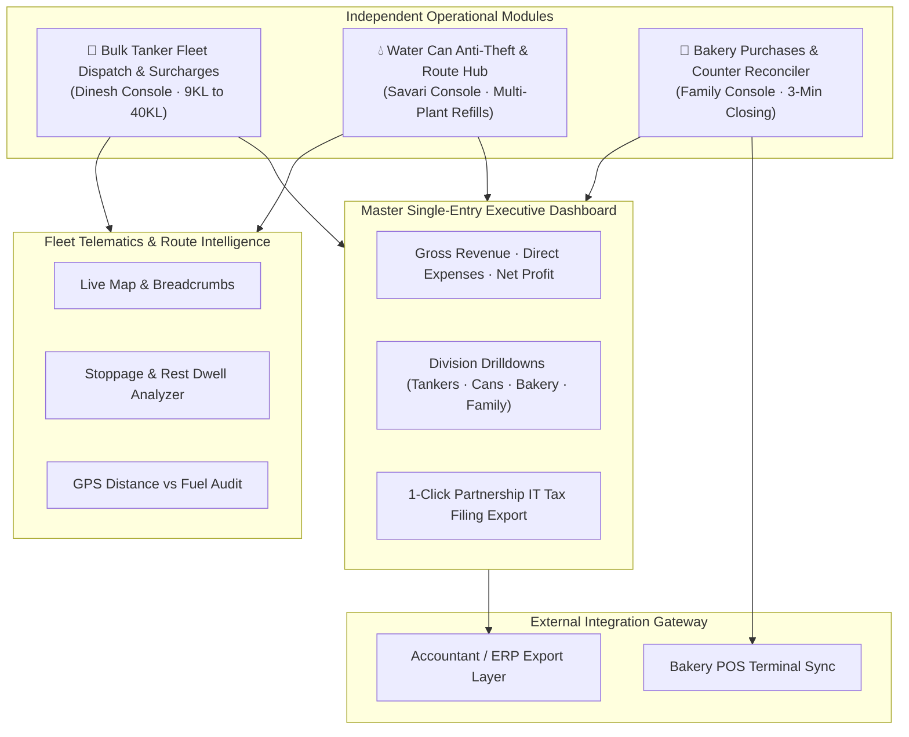

# DK Track — Web Admin & Dispatch Portal Specification

## 1. System Overview & Modular Separation

The **DK Track Web Admin Portal** maintains clean modular separation across the three physical ground businesses while rolling all financial performance up into a **Unified Executive Control Dashboard**:



---

## 2. Master Executive Dashboard (Unified Financial Control)

### 2.1 The Single-Entry Financial Engine (Money In vs Money Out)
Displays real-time business health without double-entry debit/credit jargon:

1. **Top Metric Cards**:
   - **Total Money In (Collections)**: Live cash + UPI + Bank NEFT received today / this month.
   - **Total Money Out (Expenses)**: Diesel + Plant water costs + Raw materials + Driver batta & wages + Maintenance.
   - **Net Operating Profit**: Gross Inflows minus Operating Outflows.
   - **Accounts in Hand**: `Kavin Canara Bank`, `GPay - Kavin Axis`, `Physical Cash (Safe & Drawer)`.
2. **Division Performance Tabs**:
   - **Bulk Tanker Fleet**: Trip revenue + surcharges (motor, waiting, long-distance) minus (diesel + spares + driver batta).
   - **Water Can Distribution**: Can sales collections minus (plant loading costs @ ₹8/can + driver wages + vehicle fuel).
   - **Bakery Store**: Counter sales (drawer + UPI) minus (daily 10-item raw materials + daily finance + wages).
   - **Family & Personal Drawings**: Dedicated isolation tab for non-business drawings (*"Ice Cream"*, *"Personal Recharges"*, *"Home Expenses"*), preserving pure business tax accounting.
3. **Company-Wise Receivables & Aging Drilldown**:
   - Drilldown table listing every corporate client (*Texvalley, Amirtha Milk, The Chennai Silks, Vinayaga Mill*): Total Billed, Total Collected, Unbilled Trips, and Overdue Aging (0–15, 16–30, 31–60, 60+ days).

---

## 3. Dinesh Central Tanker Dispatch Board (With Dynamic Surcharges)

### 3.1 Trip Booking Modal (Any Tanker Capacity + Itemized Extras)
- **Lorry Capacity (KL)**: Open decimal field (supports 9KL, 16KL, 24KL, 30KL, 40KL, or custom capacity).
- **Base Trip Fare**: Auto-resolved from `customer_rate_slabs`.
- **Dynamic Ground Surcharges**:
  - `[x] Motor / Pump Used`: Toggles motor pumping charge (e.g., + ₹250.00).
  - `[x] Waiting Time Detention`: Number of hours waited (e.g., 2.5 hrs @ ₹150/hr = + ₹375.00).
  - `[x] Long Distance Surcharge`: Kilometres beyond base zone (e.g., 35 km @ ₹20/km = + ₹700.00).
  - `[x] Miscellaneous / Tolls`: Amount + receipt upload.
- **Total Billing Amount**: Automatically computed and visible on dispatch slip.

---

## 4. Savari Water Can Distribution Console (Multi-Plant Refill Tracking)

### 4.1 Multi-Intake Day Shift Manager
Supports drivers refilling cans multiple times throughout the day (*Image 3: Load 1: 72, Load 2: 84, Load 3: 57*):
1. **Running Plant Intake Ledger**:
   - Displays all refills logged for the vehicle today with plant slip numbers and photos.
   - Live tally: $$\text{Total Loaded} = \text{Load 1} + \text{Load 2} + \text{Load 3} = 213\text{ Cans}$$
2. **Real-Time Truck Stock & Cash Counter**:
   - Computes: $$213\text{ Loaded} - 188\text{ Delivered} = \mathbf{25\text{ Cans on Truck}}$$
   - Live Cash in Driver's Pocket: **₹1,810.00**.
3. **Surprise Spot Audit / Flying Squad Console**:
   - Shows live location of Tata Ace on town map.
   - 1-click generation of expected physical audit count (25 full cans, 188 empty cans, ₹1,810 cash) for instant road inspections.

---

## 5. Delivery Route Intelligence & Stoppage / Dwell Time Analyzer

Solves driver route deviations, excessive idling, and inflated fuel expense claims:

```
+---------------------------------------------------------------------------------+
|  📍 வழித்தட மற்றும் நிறுத்த ஆய்வறிக்கை (ROUTE & STOPPAGE INTELLIGENCE)            |
|  வண்டி: TN 38 BX 4412 (Tata Ace) | டிரைவர்: Raja | தேதி: 2026-10-30             |
+---------------------------------------------------------------------------------+
|  மொத்த தூரம் (GPS Distance): 72.4 km | ஓடோமீட்டர் பதிவு (Odometer): 74.0 km       |
|  எரிபொருள் திறன் (Fuel Efficiency): 11.2 km/L | டீசல் செலவு: ₹ 650 (சரியாக உள்ளது) |
+---------------------------------------------------------------------------------+
|  நிறுத்தங்களின் கால அட்டவணை (Route Timeline & Stoppages):                       |
|                                                                                 |
|  08:15 AM - 08:35 AM · Main RO Treatment Plant · ஆலை ஏற்றுதல் (20 mins) 🟢      |
|  09:05 AM - 09:12 AM · Black Pekoe Tea · டெலிவரி (7 mins · ₹60 Cash) 🟢          |
|  09:20 AM - 09:34 AM · Aran Cafe - 1 · டெலிவரி (14 mins · ₹280 Cash) 🟢         |
|  11:15 AM - 12:05 PM · Highway Tea Stall · தேநீர் இடைவேளை (50 mins) ⚠️ எச்சரிக்கை|
|  01:00 PM - 01:25 PM · Main RO Treatment Plant · 2வது ஏற்றுதல் (25 mins) 🟢    |
|  02:10 PM - 02:22 PM · Surya Tex - 1 · டெலிவரி (12 mins · ₹260 Credit) 🟢       |
+---------------------------------------------------------------------------------+
```

### Key Capabilities:
1. **Automated Stop Categorization**: Automatically identifies stops at customer geofences, bottling plants, fuel stations, and unauthorized extended halts (>30 mins).
2. **GPS Distance vs Fuel Expense Auditor**: Automatically calculates the exact GPS route distance (e.g., 72.4 km) and flags fuel claims if the driver submits fuel receipts exceeding normal consumption.

---

## 6. Bakery & Retail Operations with Future POS Integration

### 6.1 Fast 3-Minute Evening Counter Reconciler
Matches physical notebook (*Image 1*):
- Drawer Cash ("Box Cash") + Coins.
- Less Cash Expenses paid from drawer.
- UPI Collections (GPay/PhonePe).
- Wastage items (Bajji, Egg Bonda, Puffs, Unsold Milk).
- Net Cash to Bank calculated in under 3 minutes.

### 6.2 External POS & Barcode Scanner Integration Gateway
- **POS Registry**: Registers physical Android POS terminals or billing counters.
- **Real-Time Transaction Sync**: Ingests counter sales via webhook with idempotency keys.
- **Supplier Ledger**: Tracks vendor balances for ingredients and packaging.
