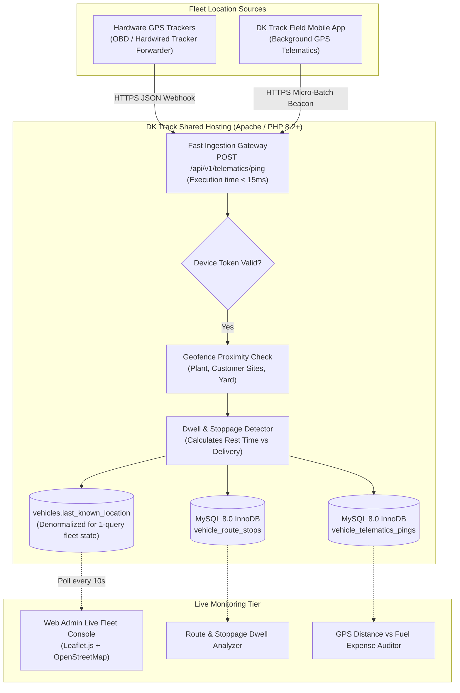

# DK Track — Fleet Tracking & Telematics Specification (Shared-Hosting Engineered)

## 1. Objectives & Ground Reality

DK Enterprises operates 5 active water tankers + 2 spare lorries, plus a Tata Ace distribution truck. The client explicitly confirmed during requirements gathering:
> *"இது எல்லா வண்டியும் ஜிபிஎஸ் வச்சிருக்கோம்ண்ணா... எந்தெந்த வண்டி எங்கெங்கு போகுது வருதுன்னு நான் இதை பார்த்துக்கோங்க..."*

In addition, the delivery agent portal must be **GPS-enabled**, track the exact **route**, record **on-the-spot payment timestamps**, and calculate **stoppage/rest time** and **fuel distance verification**:
- Where the vehicle stopped and how long it remained there (dwell time).
- Accurate distance covered (KM) to cross-verify against claimed fuel expenses.
- Real-time location during multiple plant refills (Load 1, Load 2, Load 3...).

---

## 2. Ingestion Architecture on Shared Hosting



---

## 3. Stoppage & Rest Dwell Time Detection Algorithm

To identify where a driver rested or spent excessive time without running complex background servers, the system analyzes consecutive GPS pings during micro-batch ingestion:

```php
namespace App\Services;

use Carbon\Carbon;
use Illuminate\Support\Facades\DB;

class StoppageDetectorService
{
    private const SPEED_STOPPED_THRESHOLD_KMH = 2.0;
    private const MIN_DWELL_MINUTES_TO_LOG_STOP = 3;

    public function processPing(int $vehicleId, float $lat, float $lng, float $speed, Carbon $recordedAt, ?int $canRouteId = null): void
    {
        $lastStop = DB::table('vehicle_route_stops')
            ->where('vehicle_id', $vehicleId)
            ->whereNull('departure_time')
            ->latest('arrival_time')
            ->first();

        $isStationary = ($speed < self::SPEED_STOPPED_THRESHOLD_KMH);

        if ($isStationary) {
            if (!$lastStop) {
                // Vehicle just stopped!
                DB::table('vehicle_route_stops')->insert([
                    'vehicle_id' => $vehicleId,
                    'can_route_id' => $canRouteId,
                    'latitude' => $lat,
                    'longitude' => $lng,
                    'arrival_time' => $recordedAt,
                    'stop_category' => 'rest_break', // Will refine with geofence
                    'created_at' => now(),
                ]);
            }
        } else {
            if ($lastStop) {
                // Vehicle started moving again! Close the stop
                $dwellMinutes = Carbon::parse($lastStop->arrival_time)->diffInMinutes($recordedAt);

                if ($dwellMinutes >= self::MIN_DWELL_MINUTES_TO_LOG_STOP) {
                    DB::table('vehicle_route_stops')->where('id', $lastStop->id)->update([
                        'departure_time' => $recordedAt,
                        'dwell_duration_minutes' => $dwellMinutes,
                    ]);
                } else {
                    // Micro-stop (traffic signal) - delete transient record
                    DB::table('vehicle_route_stops')->where('id', $lastStop->id)->delete();
                }
            }
        }
    }
}
```

---

## 4. GPS Distance Calculation vs Fuel Expense Auditor

Fuel theft is a common leakage point in transport fleets. The system cross-examines claimed fuel receipts against actual GPS road distance:

1. **Haversine Distance Summation**:
   $$\text{GPS Route Distance} = \sum_{i=1}^{N-1} 2R \cdot \arcsin\left(\sqrt{\sin^2\left(\frac{\Delta \phi}{2}\right) + \cos(\phi_i)\cos(\phi_{i+1})\sin^2\left(\frac{\Delta \lambda}{2}\right)}\right)$$
2. **Fuel Efficiency Audit Formula**:
   $$\text{Observed Mileage} = \frac{\text{GPS Distance (KM)}}{\text{Claimed Diesel Litres}}$$
   - Standard Tata Ace diesel efficiency: **11–13 km/L**.
   - Standard 24KL Bulk Tanker efficiency: **3.5–4.5 km/L**.
   - If a driver claims 50 litres of diesel for a 72 km route (1.44 km/L), the system immediately flags: **`EXCESS_FUEL_CLAIM_DETECTED`** for Dinesh's manual approval.

---

## 5. Delivery Agent Portal Telematics & On-The-Spot Payment Recording

When the delivery boy records a customer delivery:
1. **Accurate Timestamp**: Recorded to the exact second (e.g., `2026-10-30 09:34:12`).
2. **GPS Fix**: High-accuracy mobile GPS coordinate logged simultaneously.
3. **Stop Association**: Automatically links the customer drop with the active route stop, proving the delivery boy was physically present at *Aran Cafe - 1* when collecting ₹280 cash.
