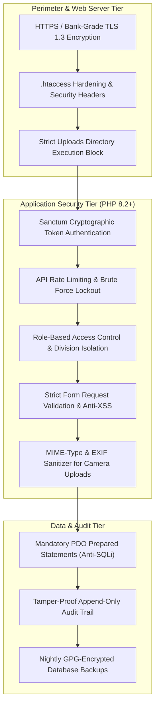

# DK Track — Security Standards, Hardening & Compliance Specification

## 1. Security Architecture for Shared Hosting

Shared hosting environments share CPU, RAM, and web server processes across multiple accounts on a single physical server. Therefore, **DK Track** implements strict multi-layered application-level defense-in-depth:



---

## 2. Shared Hosting `.htaccess` Hardening Rules

Deploy this hardened `.htaccess` file directly in the public root (`public_html/`) and uploads directory:

### 2.1 Public Root `.htaccess`
```apache
# ----------------------------------------------------------------------
# DK Track Public Security Configuration
# ----------------------------------------------------------------------

# 1. Disable Directory Browsing
Options -Indexes

# 2. Prevent Access to Hidden Files & Sensitive Assets
<FilesMatch "^\.">
    Order allow,deny
    Deny from all
</FilesMatch>

<FilesMatch "(composer\.json|composer\.lock|package\.json|\.env|\.git|\.md|artisan)$">
    Order allow,deny
    Deny from all
</FilesMatch>

# 3. Security HTTP Response Headers
<IfModule mod_headers.c>
    Header set X-Content-Type-Options "nosniff"
    Header set X-Frame-Options "SAMEORIGIN"
    Header set X-XSS-Protection "1; mode=block"
    Header set Referrer-Policy "strict-origin-when-cross-origin"
    Header set Permissions-Policy "geolocation=(self), camera=(self), microphone=()"
    Header always set Strict-Transport-Security "max-age=31536000; includeSubDomains; preload"
</IfModule>

# 4. Standard Laravel URL Rewriting
<IfModule mod_rewrite.c>
    RewriteEngine On
    RewriteCond %{HTTPS} !=on
    RewriteRule ^ https://%{HTTP_HOST}%{REQUEST_URI} [L,R=301]

    RewriteCond %{REQUEST_FILENAME} !-d
    RewriteCond %{REQUEST_FILENAME} !-f
    RewriteRule ^ index.php [L]
</IfModule>
```

### 2.2 Uploads Directory `.htaccess` (Anti-Webshell Defense)
In `public_html/uploads/`, disable script execution completely so that even if a malicious file is uploaded, the web server treats it as plain text and will not execute it:
```apache
# Deny PHP execution in uploads directory
<FilesMatch "\.(php|php5|php7|php8|phtml|phar|pl|py|cgi|sh|bash)$">
    Order Deny,Allow
    Deny from all
</FilesMatch>
php_flag engine off
Options -ExecCGI
```

---

## 3. Authentication & Session Security

1. **Token Authentication**: Laravel Sanctum with 256-bit entropy tokens.
2. **Device Fingerprinting**: Field drivers authenticate using Phone Number + PIN/Password + Device UUID. Tokens are bound to the specific Android device hardware ID to prevent credential sharing.
3. **Brute Force Lockout**:
   - Max 5 failed login attempts per IP/Phone within 10 minutes.
   - Automatic 15-minute temporary lockout upon violation.
4. **Session Expiry**:
   - Web Admin Portal tokens expire after 12 hours of inactivity.
   - Field Driver Mobile tokens remain persistent for 30 days but require immediate re-verification if device fingerprint shifts.

---

## 4. Role-Based Access Control (RBAC) Permissions Matrix

| Resource / Action | Owner | Dinesh (Tanker) | Savari (Water Cans) | Bakery Family | Field Driver | Auditor |
| :--- | :---: | :---: | :---: | :---: | :---: | :---: |
| **View Net P&L & Bank Balances** | ✅ Full | ❌ Blocked | ❌ Blocked | ❌ Blocked | ❌ Blocked | ✅ View Only |
| **Manage Tanker Trip Sheets** | ✅ Full | ✅ Full | ❌ Blocked | ❌ Blocked | ⚠️ Assigned Only | ✅ View Only |
| **Approve Driver Fuel & Batta** | ✅ Full | ✅ Full | ❌ Blocked | ❌ Blocked | ❌ Blocked | ✅ View Only |
| **Manage Can Routes & Pricing** | ✅ Full | ❌ Blocked | ✅ Full | ❌ Blocked | ❌ Blocked | ✅ View Only |
| **Verify Evening Cash Surrender**| ✅ Full | ❌ Blocked | ✅ Full | ❌ Blocked | ⚠️ Read Tally | ✅ View Only |
| **Bakery Purchases & Drawer Closing**| ✅ Full | ❌ Blocked | ❌ Blocked | ✅ Full | ❌ Blocked | ✅ View Only |
| **Generate B2B Corporate Invoices** | ✅ Full | ✅ Full | ❌ Blocked | ❌ Blocked | ❌ Blocked | ✅ View Only |
| **Modify Customer Rate Slabs** | ✅ Full | ⚠️ Request | ⚠️ Request | ❌ Blocked | ❌ Blocked | ❌ Blocked |
| **View Live Fleet GPS Console** | ✅ Full | ✅ Full | ✅ Can Truck | ❌ Blocked | ⚠️ Self Vehicle | ❌ Blocked |

---

## 5. Tamper-Proof Audit Logging & Anti-Cheating Controls

### 5.1 Immutable Append-Only Ledger
- All modifications to past trips, cash amounts, customer balances, and raw material purchase logs generate an un-deletable row in `audit_logs`.
- Database user permissions for the standard web application prevent `DELETE` or `UPDATE` queries on `audit_logs`.

### 5.2 Anti-Pilferage Lockout Safeguards
1. **The 24-Hour Trip Lock**: Once a tanker trip is marked `completed` and the gate pass is attached, drivers cannot alter kilometres, fuel claims, or arrival timestamps.
2. **Shift Lock Rule**: Once an evening cash surrender is signed off by Savari, the delivery records for that route are permanently frozen. Any subsequent adjustment requires an Owner Override with recorded audit justification.
3. **Spot-Audit Anti-Collusion**: Field delivery records cannot be deleted by drivers on their phone. If a delivery boy deletes the mobile app, local SQLite transactions are recovered upon re-install from server backups.

---

## 6. Safe Camera Upload Pipeline

Field staff upload photos of paper gate passes, fuel pump metres, cash slips, and vegetable receipts. The server processes all uploads through this security pipeline:

```php
namespace App\Services;

use Illuminate\Http\UploadedFile;
use Illuminate\Support\Str;
use Intervention\Image\Facades\Image;

class SecureImageUploader
{
    private const ALLOWED_MIMES = ['image/jpeg', 'image/png', 'image/webp'];
    private const MAX_SIZE_BYTES = 5242880; // 5MB

    public function uploadAndSanitize(UploadedFile $file, string $folder = 'receipts'): string
    {
        // 1. Verify strict MIME type
        if (!in_array($file->getMimeType(), self::ALLOWED_MIMES, true)) {
            throw new \InvalidArgumentException('Invalid image format. Only JPG, PNG, and WebP are allowed.');
        }

        // 2. Generate random cryptographic file name (never preserve original client filename)
        $fileName = Str::random(32) . '.webp';
        $destinationPath = storage_path('app/secure_uploads/' . $folder);

        if (!file_exists($destinationPath)) {
            mkdir($destinationPath, 0755, true);
        }

        // 3. Re-encode image, strip malicious EXIF metadata, and downscale to 1200px max width
        $img = Image::make($file->getRealPath());
        $img->resize(1200, null, function ($constraint) {
            $constraint->aspectRatio();
            $constraint->upsize();
        });
        
        // Save as WebP with 80% quality for optimal bandwidth
        $img->save($destinationPath . '/' . $fileName, 80, 'webp');

        return 'secure_uploads/' . $folder . '/' . $fileName;
    }
}
```

---

## 7. Automated Daily Backups & Disaster Recovery

A nightly cron job executing at 03:00 AM automates database backups on shared hosting:

```bash
# Shared Hosting Nightly Backup Cron
0 3 * * * /usr/bin/mysqldump -u dkenterprises_db -p'DB_PASSWORD' dkenterprises_erp | gzip > /home/dkenterprises/backups/db_$(date +\%Y\%m\%d).sql.gz && find /home/dkenterprises/backups/ -type f -mtime +14 -delete
```
- Retains rolling 14 daily backup snapshots.
- Can be securely piped to off-site cloud storage (Google Drive / S3 / Backblaze B2) using a lightweight PHP script.
