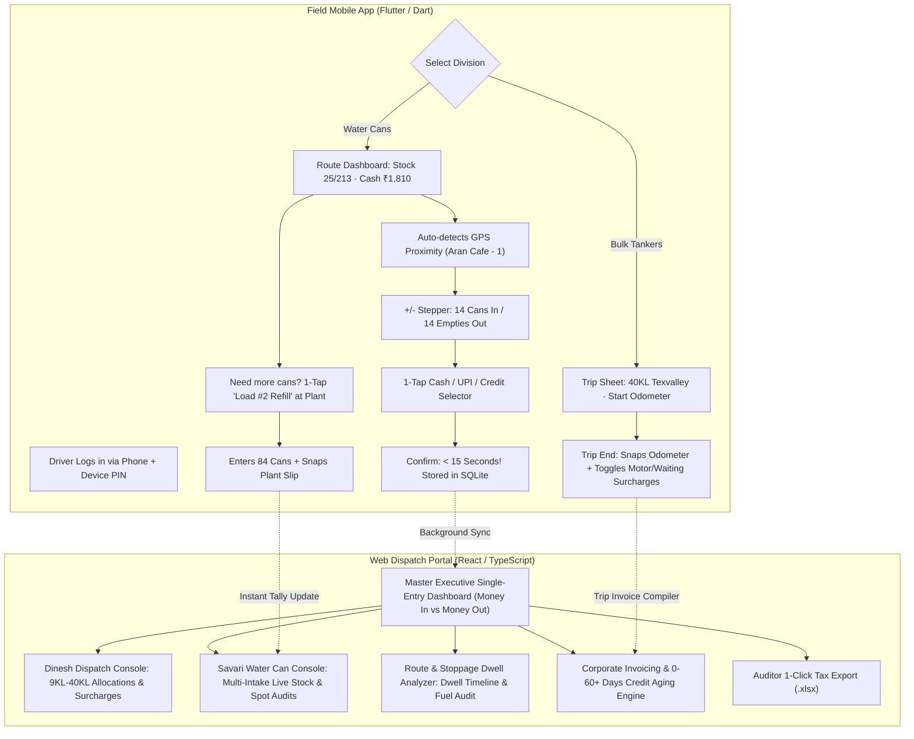

# DK Track — Google Stitch UI Prompts & Design System Specification

## 1. Anti-"Generic AI" Design Manifesto

> **CORE PRINCIPLE: GROUNDED TACTICAL UTILITY OVER GENERIC AI SLOP**
> Most AI-generated UI designs look identical: oversaturated purple/indigo gradients, floaty frosted-glass cards, meaningless abstract 3D spheres, giant wasted whitespace, and soft pastel widgets that are completely useless for ground-level field operations.
>
> **DK Track must look and feel like a high-precision, industrial-grade operational machine.**
> It draws visual inspiration from mission-critical flight dispatch consoles, tactical maritime vessel trackers (like MarineTraffic/Flightradar), and rugged field logistics tools (like Samsara and Caterpillar Fleet), refined with modern Swiss typographic clarity and authentic Tamil Nadu vernacular context.

---

## 2. Master Design Tokens & Palette

### 2.1 The "Tactical Fleet & Industrial Water" Color System
- **Canvas / Background**: `Deep Matte Carbon` (`#0B0F17`) for Dark Console Mode; `Crisp Engineered White-Grey` (`#F8FAFC`) for Daytime Light Mode.
- **Card Surfaces**: `Subtle Graphite` (`#111827`) with crisp 1px borders (`#1F2937`) — zero blurry drop-shadows.
- **Primary Operational Accent**: `High-Vis Water Turbine Blue` (`#0284C7` / `#38BDF8`) for tanker actions and primary dispatches.
- **Cash & Revenue (Money In)**: `Tactical Emerald Mint` (`#059669` / `#10B981`) — represents cash banked and matched reconciliation.
- **Expenses & Outflows (Money Out)**: `Hazard Coral Red` (`#DC2626` / `#EF4444`) — represents diesel costs, punctures, and shortages.
- **Surcharges & Alerts (Detention / Motor)**: `Industrial Safety Amber` (`#D97706` / `#F59E0B`) — represents waiting time detention and pump fees.
- **Typography Colors**: Primary Text (`#F9FAFB`), Muted Metadata (`#94A3B8`), Subtle Borders (`#334155`).

### 2.2 Typography
- **English UI & Numbers**: `Plus Jakarta Sans` (Headers/Buttons) + `JetBrains Mono` or `Inter` (Tabular currency & odometer numerals).
- **Tamil Vernacular**: `Noto Sans Tamil` (Weight: 600 SemiBold & 700 Bold for driver buttons).

---

## 3. PROMPT 1: Web Admin & Central Dispatch Portal (For Google Stitch)

```text
[PROJECT TITLE]: DK Track — Industrial Fleet Logistics, Dispatch & Single-Entry Executive ERP
[DEVICE / PLATFORM]: Desktop Web Application (1920x1080 Full HD, Dense Tactical Dashboard Layout)
[DESIGN AESTHETIC]: Industrial Utility & High-Density Operational Dispatch Console. NOT a generic purple SaaS template. Crisp, dark slate theme (#0B0F17) with high-contrast safety accents, razor-thin 1px borders (#1E293B), tabular data density, and zero generic soft pastel gradients. Real-world business context: Bulk Water Tankers (9KL to 40KL), Water Can Anti-Theft Distribution, and Bakery Store Retail in Tamil Nadu, India.

[LAYOUT ANATOMY]:
1. TOP OPERATIONAL APEX BAR (Height: 56px, Dark Steel #0F172A):
   - Left: Brand icon (industrial water tanker silhouette in #38BDF8) + Text: "DK TRACK · ENTERPRISE LOGISTICS & ACCOUNTS" + Live Status Badge: "6 OF 7 LORRIES ON ROAD 🟢".
   - Center: Real-time ticker: "DIESEL TODAY: ₹8,420 | TRIPS COMPLETED: 14 | MONEY IN TODAY: ₹1,48,500 | CASH IN HAND: ₹34,200".
   - Right: Quick Division Switcher [🚛 TANKERS | 💧 WATER CANS | 🥖 BAKERY | 💰 MASTER P&L] + Language Toggle [தமிழ் / EN] + Profile "Owner / Dinesh".

2. DUAL-PANE MAIN STAGE (Split 60% Left / 40% Right):
   - LEFT PANE (High-Density Dinesh Dispatch Board & Surcharge Engine):
     * Header with action button: "+ NEW TANKER DISPATCH (புதிய ட்ரிப் பதிவு)" in vibrant #0284C7.
     * Active Trip Kanban Cards:
       - Card 1: Lorry "TN 34 AF 4954" | Capacity badge: "24.0 KL BULK" | Driver: "Suresh (98421XXXXX)" | Destination: "Texvalley Corporate Campus (88KL Contract - Trip 3)" | Meter Start: 1,42,810 km.
       - Surcharges Active Tag Row: [⚡ MOTOR USED: +₹250] [⏳ WAITING: 2.0 hrs (+₹300)] [🛣️ TOLL: ₹180].
       - Gross Trip Value: "₹ 3,230" (Base ₹2,500 + Surcharges ₹730).
       - Live Action Buttons: [📍 GPS REPLAY] [📄 PRINT TRIP SHEET] [📞 CALL DRIVER].
     * Bottom Table: "Corporate Credit Aging & Collections (₹4.8L Pending)":
       - Table columns: Client Name, Billing Cycle (15-Day / Monthly), Unbilled Trips, 0-15d, 16-30d, 31-60d (Amber), 60+d Critical (Flashing Red with follow-up note "Amirtha Milk: Promise Oct 31").

   - RIGHT PANE (Live Map & Fleet Stoppage Dwell Analyzer):
     * Dark Vector Leaflet/OpenStreetMap styled map of Coimbatore/Tirupur region.
     * Vehicle Markers:
       - Blue Tanker Icons with speed labels (e.g., "44 km/h moving south").
       - Cyan Mini-Truck Icon for Tata Ace can truck.
     * Overlaid Geofences: Green ring around "Main RO Treatment Plant", Cyan ring around "Texvalley Campus", Purple ring around "Amirtha Dairy".
     * Route Stoppage Dwell Intelligence Drawer below map:
       - Visual vertical timeline showing:
         • 08:15 AM - 08:35 AM · Main RO Plant · 20 mins (Loading Load #1)
         • 09:20 AM - 09:34 AM · Aran Cafe · 14 mins (Delivered 14 Cans · ₹280 Cash)
         • 11:15 AM - 12:05 PM · Highway Tea Stall · 50 mins ⚠️ WARNING: Extended Rest Stop!
         • Total GPS Distance: 72.4 km | Claimed Diesel: 6.5 Litres (Efficiency: 11.1 km/L - NORMAL).

3. BOTTOM PERSISTENT DRAWER (Master Single-Entry P&L Ticker):
   - Displays real-time Money In vs Money Out ledger:
     [TM Water Supply: +₹98,000 | Can Distribution: +₹22,500 | Bakery Outlet: +₹28,000 | Direct Expenses: -₹82,230 | NET OPERATING PROFIT: ₹66,270 (44.6%)]
   - Button: "📊 1-Click Auditor IT Tax Export (.xlsx)" in matte emerald green (#059669).

[AVOID / ANTI-PATTERNS]:
- NO soft purple/pink gradients, NO oversized puffy rounded corners (>12px), NO empty decorative cartoon illustrations.
- Every pixel must convey actionable fleet data, monetary figures, or vehicle status.
```

---

## 4. PROMPT 2: Field Servant & Driver Mobile App (For Google Stitch)

```text
[PROJECT TITLE]: DK Track Field — "Ticket Machine" Ultra-Fast Delivery & Driver Telematics App
[DEVICE / PLATFORM]: Native Android Smartphone (Google Pixel / Samsung Galaxy, 412x915 Portrait Mobile Wireframe)
[DESIGN AESTHETIC]: Rugged Tactical Field Utility. High-contrast outdoor readability for bright Indian sunlight. Tactile physical "Bus Ticket Machine" ergonomics. Big 48dp+ tap targets for drivers with dirty or wet hands. Zero typing required. Bilingual English + Vernacular Tamil (தமிழ்) side-by-side.

[SCREEN 1: WATER CAN ROUTE & "TICKET MACHINE" FAST ENTRY (<15s per stop)]:
1. TOP STATUS HEADER (High-Contrast Carbon & Teal #0F172A):
   - Vehicle: "TN 38 BX 4412 (Tata Ace)" | Route: "Race Course - Gandhipuram"
   - Live Stock Pill: "ஸ்டாக்: 25 / 213 Cans" (Refill #3 active)
   - Live Cash in Pocket: "பணம்: ₹ 1,810"
   - Language selector pill: [தமிழ் / EN] + Offline Status icon: "🟢 சேமிக்கப்பட்டது (Saved Offline)"

2. SMART GPS PROXIMITY CARD:
   - Green beacon card: "📍 அடுத்த கடை (Next Shop): அரண் கஃபே - 1 (Aran Cafe - 1)"
   - Proximity: "15 மீட்டரில் உள்ளீர்கள் (15m away)" [மாற்று கடை தேர்வு / Change Shop ▼]

3. TACTILE COUNTER GRID (Giant Touch Targets):
   - Section 1: "டெலிவரி செய்த கேன் (Cans Delivered)":
     Row with [-1] (big 56x56 grey box) | [ 14 ] (giant bold 32pt number) | [+1] (big 56x56 box)
   - Section 2: "திரும்பிய காலி கேன் (Empty Returned)":
     Row with [-1] | [ 14 ] | [+1]
   - Automatic Calculation Banner: "மொத்தத் தொகை (Total Fare): ₹ 280 (14 × ₹20/கேன்)"

4. 1-TAP PAYMENT SELECTOR TILES (2x2 Grid):
   - Tile 1 (Selected Emerald Green #059669): "💵 ரொக்கம் (CASH) - ₹280"
   - Tile 2 (Dark Cerulean #0284C7): "📱 GPAY / PHONEPE"
   - Tile 3 (Warning Amber #D97706): "⏳ கடன் (CREDIT)"
   - Tile 4 (Neutral Steel #334155): "📸 கேட் பாஸ் / ரசீது படம்"

5. GIANT BOTTOM SUBMIT BUTTON:
   - Full-width 64px height button in glowing safety cyan (#0284C7):
     "✅ உறுதி செய் (CONFIRM DELIVERY - 15 SECONDS)"
   - Sub-caption: "நேரம்: 09:34:12 AM · GPS பதிவு செய்யப்பட்டது"

---

[SCREEN 2: MULTI-PLANT INTAKE & FLYING SQUAD AUDIT SCREEN]:
1. PLANT REFILL TAB:
   - Header: "ஆலை ஏற்றுதல் (Water Plant Refill) · லோடு #2"
   - Pre-loaded: Load #1 (72 Cans @ 08:15 AM)
   - Current Intake: Big Stepper showing "[ 84 ] Cans Loaded"
   - Plant Slip Number input + 1-Tap Camera button: "📸 ஆலை ரசீது படம் எடு (Snap Slip)"
   - Running Total Calculation: "மொத்த கேன்கள்: 72 + 84 = 156 கேன்கள்"
   - Button: "💾 ஆலை லோடு பதிவு செய் (Save Plant Intake)"

2. FLYING SQUAD / SPOT AUDIT POPUP (For Owner/Manager):
   - Warning Strip: "🚨 திடீர் வாகன தணிக்கை (SURPRISE SPOT AUDIT)"
   - Live Telematics Data:
     • வண்டியில் இருக்க வேண்டிய கேன்கள் (Expected Cans): 25 Cans
     • டிரைவரிடம் இருக்க வேண்டிய ரொக்கம் (Expected Cash): ₹ 1,810
     • காலி கேன்கள் (Expected Empties): 188 Cans
   - Actual Verified Count input boxes: [ Cans: 25 ] [ Cash: 1810 ]
   - Result: "✅ 100% கணக்கு சரியாக உள்ளது (MATCHED)"

---

[SCREEN 3: BULK TANKER TRIP SHEET & DYNAMIC SURCHARGES (9KL - 40KL)]:
1. TRIP CARD:
   - Lorry: "TN 34 AF 4954" | Capacity: "40.0 KL Semi-Trailer" | Party: "Texvalley"
   - Start Odometer: 1,42,810 km (with thumbnail photo)
   - End Odometer input: [ 142865 ] km (Total: 55 km)

2. DYNAMIC SURCHARGE TOGGLE LIST:
   - Toggle 1: "மோட்டார் பயன்படுத்தப்பட்டதா? (Motor Used?)": [YES - ON] (+ ₹250)
   - Toggle 2: "காத்திருப்பு நேரம் (Waiting Detention)": [ 2.0 ] Hours (+ ₹300)
   - Toggle 3: "தொலைதூர கட்டணம் (Long Distance)": [ 0 ] km (+ ₹0)
   - Toggle 4: "டோல்கேட் / இதர செலவு (Toll / Misc)": [ ₹ 180 ] (+ Attached Toll Slip)
   - Total Trip Billing: "₹ 3,230 (Base ₹2,500 + Surcharges ₹730)"

3. DIGITAL RECEIVER SIGNATURE & SUBMIT:
   - Finger drawing canvas for receiver signature + Gate Pass photo snap.
   - Button: "🚀 பயணத்தை முடி (COMPLETE TRIP)"

[AVOID / ANTI-PATTERNS]:
- NO low-contrast grey text on white background (must be bold and legible under sun).
- NO tiny checkboxes or fiddly date-pickers. Everything is big-button stepped input.
```

---

## 5. UI Layout Blueprint & Interaction Flows


