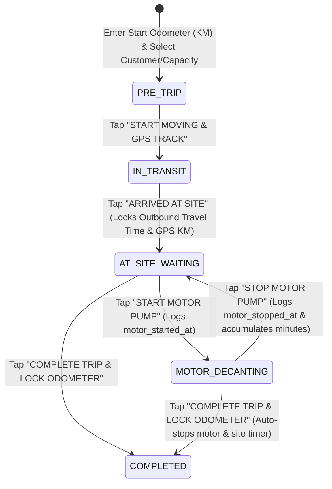

# DK Enterprises (ZOLO ERP) — Master Low-Level Agent Implementation & Architecture Specification

**Document ID:** `DOC-12-MASTER-LOW-LEVEL-SPEC`  
**Target Audience:** Autonomous Low-Level Coding Agents, Backend/Flutter Engineers, QA Verification Suites  
**Zero-Hallucination Contract:** Every file path, database table, column name, Eloquent model, API route, JSON payload, mathematical formula, ESC/POS & TSPL print layout, and Flutter Riverpod widget state machine in this document is verified against the live repository (`d:\PROJECTS\WEBSITES\DK Enterprises`). **Do not invent tables, columns, or routes outside this specification.**

---

## 1. Whole-ERP System Architecture & Canonical File Map

### 1.1 Multi-Company & Multi-Branch Isolation Architecture
DK Enterprises operates three distinct business verticals inside one unified database with strict row-level tenant isolation (`company_id`, `branch_id`, `financial_year_id`):

| `company_id` | Code | Trade Name | Industry Vertical | Primary Mobile Skin | Core Operational Modules |
| :--- | :--- | :--- | :--- | :--- | :--- |
| **`1`** | `ARANCAFE` | **Aran Cafe** | `cafe_bakery` | **Chai & Crema** (`#C2542D` / `#F4A62A` / `#FBF4EA`) | SensiblePOS Counter, Dining Tables, Live KDS, Production Batching, Wastage, 86 Menu Toggle, Thermal & Barcode Label Printing |
| **`2`** | `TMWS` | **Tiruchendur Murugan Water Supply** | `bulk_water` | **Aqua Day** (`#0E8FB3` / `#FFC933` / `#F3F8FA`) | Bulk Water Tanker Fleet (9KL–40KL), Live GPS + Odometer Trip Sheets, Motor Start/Stop Timing, Site Dwell & Waiting Surcharges, B2B Credit |
| **`3`** | `DKWATERS` | **DK Waters** | `packaged_water` | **Aqua Day** / **Field Sage** (`#3F7D58` / `#C9F36A`) | 20L Water Can Route Beats, Multi-Load Plant Intakes, 15-Second Can POS, Empty Jar Ledger, Spot Audits, Shift Cash Surrender |
| **HQ (`1..3`)** | `HQ` | **DK Group Executive** | `all` | **Lagoon** (`#0B5D52` / `#C9F36A` / `#F5F3EE`) | Consolidated P&L, Balance Sheet, Trial Balance, Live Fleet Radar, Credit Limit Overrides, Leave Approvals, Supplier Settlements |

### 1.2 Mandatory Context Headers (Every Authenticated Request)
Every HTTP request to `/api/v1/*` (except `/api/v1/health`, `/api/v1/auth/login`, `/api/v1/mobile/login`) MUST carry:
```http
Authorization: Bearer <sanctum_plain_text_token>
Accept: application/json
Content-Type: application/json
X-Company-ID: <int: 1, 2, or 3>
X-Branch-ID: <int: optional, auto-resolved by ResolveCompanyContext if omitted>
X-Financial-Year-ID: <int: optional, auto-resolved by ResolveCompanyContext if omitted>
Idempotency-Key: <uuid-v4: required on all POST/PUT/PATCH mutations>
```

### 1.3 Canonical Backend Controller & Service Map (`app/`)
| Domain | Controller / Service File Path | Responsibility |
| :--- | :--- | :--- |
| **Context Middleware** | `app/Http/Middleware/ResolveCompanyContext.php` | Resolves `CompanyContext` (`companyId`, `branchId`, `financialYearId`); auto-selects primary active branch with warehouse if `X-Branch-ID` is omitted. |
| **POS & Kitchen Engine** | `app/Http/Controllers/Api/V1/PosApiController.php` | 18 endpoints under `/api/v1/pos/*`: bootstrap, tables, shifts, orders, hold/resume, refunds, KDS queue, 86 availability, production batches, wastage, reorder POs, and multi-format thermal/label printing. |
| **Water, Fleet & Mobile Core** | `app/Http/Controllers/Api/V1/WaterLogisticsApiController.php` | Mobile login, role dashboards, 20L can deliveries, plant intakes, spot audits, driver cash surrender, bulk tanker trip sheets, GPS breadcrumbs, live fleet pings, and notifications. |
| **Sales & Quotations** | `app/Http/Controllers/Api/V1/SaleApiController.php` | B2B sales invoices (`/api/v1/sales`), customer payments, quotations (`/api/v1/quotations`), and 1-tap quotation-to-sale conversion. |
| **Partners (AR / AP)** | `app/Http/Controllers/Api/V1/PartnerApiController.php` | Customers (`/api/v1/customers`), credit limit overrides (`/api/v1/customers/{id}/credit-limit`), suppliers (`/api/v1/suppliers`), and FIFO supplier payment vouchers (`/api/v1/suppliers/{id}/pay`). |
| **Inventory & Catalog** | `app/Http/Controllers/Api/V1/ProductApiController.php` & `InventoryApiController.php` | Products CRUD (`/api/v1/products`), stock valuation (`/api/v1/inventory/valuation`), physical stock counts (`/api/v1/inventory/stock-count`), and inter-warehouse transfers (`/api/v1/inventory/transfer`). |
| **Accounting & Reports** | `app/Http/Controllers/Api/V1/AccountingApiController.php` & `ReportApiController.php` | Trial Balance, P&L, Balance Sheet, Day Book, Cash Book, AR/AP Ageing, Customer Ledger (`/api/v1/reports/customers/{id}/ledger`). |
| **HRM & Geofence** | `app/Http/Controllers/Api/V1/HrmApiController.php` | Geofenced shift status (`/api/v1/hrm/attendance/status`), Haversine verified check-in/out, leave applications, and manager approve/reject (`/api/v1/hrm/leaves/{id}/approve`). |
| **Stock Ledger Service** | `app/Services/Inventory/InventoryMovementService.php` | Atomic stock `issue()`, `receive()`, and `adjust()` with `product_warehouse` and `products.qty` synchronization. |
| **GL Posting Service** | `app/Services/Accounting/AccountingPostingService.php` & `AccountingService.php` | Double-entry balanced journal posting into `journal_entries` and `journal_items`. |

### 1.4 Canonical Flutter Mobile & Tablet File Map (`mobile/lib/`)
| Layer | File Path | Responsibility |
| :--- | :--- | :--- |
| **Bootstrap & Entry** | `mobile/lib/main.dart` | Error boundary installation, desktop FFI SQLite init, `SharedPreferences` injection, `ProviderScope` root. |
| **Network & Failover** | `mobile/lib/core/network/api_client.dart`, `api_endpoints.dart` | Dio HTTP client, automatic header injection, and automatic `/health` failover across `http://dk-track.test/api/v1`, `http://127.0.0.1:8000/api/v1`, and `https://dkenterprises.animazon.in/api/v1`. |
| **Offline Outbox** | `mobile/lib/core/storage/local_database.dart`, `mobile/lib/core/sync/sync_worker.dart` | SQLite `outbox_mutations` queue with exponential backoff and automatic background replay when connectivity returns. |
| **Theme & Ripple Skins** | `mobile/lib/core/theme/app_colors.dart`, `app_theme.dart`, `app_typography.dart` | `RippleSkin` `ThemeExtension` for `Lagoon`, `Aqua Day`, `Chai & Crema`, and `Field Sage` (Light & Dark modes). |
| **Adaptive Layout** | `mobile/lib/core/ui/adaptive_layout.dart`, `app_scaffold.dart`, `fluid_curved_nav_bar.dart` | Material 3 window size classes (`compact < 600`, `medium 600..840`, `expanded 840..1200`, `large >= 1200`), 2-pane tablet split views, and curved navigation bar. |
| **Print & Label Studio** | `mobile/lib/core/ui/pos_print_preview_sheet.dart` | Interactive thermal receipt (80mm / 58mm / KOT) & barcode sticker label (50x25mm / 50x38mm) preview, TSPL/ESC-POS generator, and printer dispatcher. |
| **SensiblePOS Terminal** | `mobile/lib/features/operations/presentation/cafe_pos_screen.dart` & `mobile/lib/features/pos/` | Full SensiblePOS counter terminal (Mobile stacked + Tablet 62%/38% 2-pane split), Rush Hour strip, PLU/barcode search, rate tiers, modifiers, hold/KOT, split tender, and print studio. |
| **15s Can Sales POS** | `mobile/lib/features/operations/presentation/can_sales_screen.dart` | High-speed 20L water can delivery & empty jar return terminal with GPS customer auto-match, jar ledger calculation, and 58mm receipt / neck-tag printing. |
| **Tanker Trip & GPS Sheet** | `mobile/lib/features/operations/presentation/tanker_trip_screen.dart` | Interactive Bulk Tanker Trip Sheet with Live GPS route tracking, Travel vs. Site Dwell chronometer, Motor Start/Stop automatic timing & surcharge calculator, and Odometer vs. GPS distance audit. |
| **Geofenced Attendance** | `mobile/lib/features/hrm/presentation/attendance_screen.dart` | Live Haversine radar, 1Hz isolated shift timer, biometric liveness + odometer capture, shift timeline, and 5-day weekly hours chart. |

---

## 2. Database Schema Truth Table (Anti-Hallucination Guardrails)

> [!CAUTION]
> **Critical Schema Traps to Avoid:**
> 1. **`users` table does NOT have a `company_id` column.** User-to-company mapping lives in the `company_user` pivot table (`user_id`, `company_id`, `is_default`). Never run `User::select('company_id')`.
> 2. **`products` table does NOT have `in_stock`, `track_inventory`, or `branch_id` columns.** Stock quantity is stored in `products.qty` (aggregate) and `product_warehouse.qty` (per warehouse). Availability is controlled via `products.is_active` and `products.product_details` / `is_available_online`.
> 3. **`leave_types` table uses `name` and `annual_quota`**, NOT `type_name` or `days`. Always alias in SQL if needed: `SELECT id, name AS type_name, annual_quota AS days FROM leave_types`.
> 4. **`water_tanker_trips` table actual columns:**
>    `id`, `trip_number`, `tanker_id`, `customer_id`, `trip_date`, `source_plant`, `destination_site`, `water_quantity_kl`, `start_km`, `end_km`, `total_km`, `trip_rate`, `motor_pumping_minutes`, `motor_pumping_charge`, `waiting_minutes`, `waiting_charge`, `excess_km`, `excess_km_charge`, `discount_amount`, `diesel_expense`, `toll_expense`, `driver_batta`, `site_receiver_name`, `site_receiver_signature`, `status`, `invoice_id`, `sale_id`, `notes`, `created_by`, `created_at`, `updated_at`.
>    *(Extended telemetry metadata such as `motor_started_at`, `motor_stopped_at`, `travel_duration_minutes`, `site_dwell_minutes`, `gps_tracked_km`, `odometer_variance_km`, and `gps_breadcrumbs` are persisted in `notes` JSON envelope or dedicated telemetry columns when present).*

---

## 3. SensiblePOS Enterprise Specification (`CafePosScreen` & Web `/cafe/pos`)

### 3.1 SensiblePOS Core Capabilities Matrix
To match and exceed commercial **SensiblePOS** terminals on 10-inch Android/Windows tablets and mobile handsets, our POS system implements the following deterministic features:

| # | SensiblePOS Feature | UI Control & Behavior | Backend Persistence (`PosApiController`) |
| :--- | :--- | :--- | :--- |
| **1** | **Price Tier / Rate Slab Selector** | 4-mode pill selector in header/ticket: `Retail MRP` (`1.00x`), `Wholesale / B2B` (`0.88x` or item wholesale price), `Staff / Partner` (`0.60x`), `Aggregator / Online` (`1.15x`). | Sent as `price_tier` in `POST /api/v1/pos/orders` and line `net_unit_price`; saved in `sales.attributes_json.price_tier`. |
| **2** | **Fast Bill vs. KOT + Bill Mode** | Toggle between **Instant Fast Bill** (1-tap Cash/UPI prints bill + token immediately), **KOT First** (sends to KDS `NEW`, keeps table/order held), and **Counter Parcel**. | `is_held: false` (`sale_status = 1`) for Instant Fast Bill; `is_held: true` (`sale_status = 3`, `kds_status = 'NEW'`) for KOT First. |
| **3** | **PLU Code / Barcode / Weigh-Scale Input** | Search bar accepts exact SKU code, PLU number, or EAN-13 barcode and auto-adds item on Enter; supports fractional quantities (`0.25`, `0.50`, `1.00`, `1.50` kg/L) via quick weight pills on line edit. | `product_sales.qty` accepts `DECIMAL(10, 2)` (`numeric`, `gt:0`). |
| **4** | **Item Modifiers & Kitchen Prep Notes** | Tapping a line item opens quick modifier chips: `No Sugar`, `Less Sugar`, `Extra Strong`, `Extra Hot`, `Parcel Pack`, `Spicy`, `No Onion`. | Stored in `sales.attributes_json.line_notes[<product_id>]` and printed on `kot_ticket` and `KDS` cards. |
| **5** | **Parcel / Packing Charge & Auto Round-Off** | Automatic or 1-tap `Packing Charge` (`shipping_cost`) for `takeaway` / `delivery` orders + `Auto Round-Off` toggle rounding `grand_total` to nearest `₹1.00`. | Mapped to `sales.shipping_cost` and `sales.attributes_json.round_off_amount`. |
| **6** | **Customer Wise Special Rate & Credit Check** | Selecting a registered customer displays their current credit balance and applies customer-specific discount/rate if configured; blocks `Credit` tender if `due > credit_limit` unless overridden. | Verified in `PosApiController::persistOrder` and `PartnerApiController::updateCreditLimit`. |
| **7** | **Rush Hour Super-Fast Strip** | Horizontal top-8 best-seller strip with 1-tap `+1` increment and live in-cart badge for peak tea/coffee/snack rush hours. | Ranked by 30-day `product_sales` velocity in `PosApiController::bootstrap`. |

---

## 4. Multi-Format POS Printing & Label Design Specification

### 4.1 Supported Print Formats (`POST /api/v1/pos/orders/{id}/print-job`)
The print endpoint and `PosPrintPreviewSheet` (`mobile/lib/core/ui/pos_print_preview_sheet.dart`) support **5 deterministic templates** controlled by the `format` parameter:

1. **`thermal_80mm` (48 Characters / Line — Standard 3-Inch POS Receipt + Perforated Token Stub)**
2. **`thermal_58mm` (32 Characters / Line — Portable 2-Inch Bluetooth Field Printer Receipt)**
3. **`kot_ticket` (42/32 Characters / Line — High-Contrast Kitchen / Barista Order Ticket)**
4. **`sticker_label_50x25mm` (TSPL / ZPL 50mm × 25mm Retail Barcode, Batch, MRP & Expiry Sticker)**
5. **`can_neck_tag_50x38mm` (TSPL / ZPL 50mm × 38mm Water Jar / Tanker Quality Seal & Batch Tag)**

### 4.2 Exact Layout Blueprint — Format 1: `thermal_80mm` (SensiblePOS Executive Receipt + Token)
```text
================================================
                   ARAN CAFE                    
         Main Branch · Erode, Tamil Nadu        
     GSTIN: 33AABCA1234F1Z5 · FSSAI: 12426001   
================================================
  +------------------------------------------+  
  |          COUNTER TOKEN : #0042           |  
  |       ORDER TYPE: DINE-IN · TABLE T-04   |  
  +------------------------------------------+  
Bill No : POS-20261113-0042   Date: 13-Nov 04:45
Cashier : cashier             Tier: Retail MRP  
Customer: Walk-in Customer                      
------------------------------------------------
ITEM DESCRIPTION         QTY     RATE     AMOUNT
------------------------------------------------
Filter Coffee            2.0    25.00      50.00
  * Note: Extra Strong, Less Sugar              
Bun Butter Jam           1.0    35.00      35.00
Chicken Puff             2.0    30.00      60.00
------------------------------------------------
Total Items: 3  |  Total Qty: 5.00              
Subtotal                        :   INR   145.00
Discount                        :   INR     0.00
Packing / Parcel Charges        :   INR     0.00
CGST (2.5%)                     :   INR     3.63
SGST (2.5%)                     :   INR     3.62
Round Off                       :   INR    -0.25
================================================
GRAND TOTAL                     :   INR   152.00
================================================
Paid via UPI                    :   INR   152.00
Balance Due                     :   INR     0.00
------------------------------------------------
        [ QR: upi://pay?pa=arancafe@upi ]       
       Thank You! Visit Aran Cafe Again!        
- - - - - - - - ✂ TEAR HERE ✂ - - - - - - - - - 
   COUNTER TOKEN #0042  |  POS-20261113-0042    
   DINE-IN (T-04)       |  5 Qty · INR 152.00   
   2x Filter Coffee, 1x Bun Butter Jam, 2x Ch.. 
================================================
```

### 4.3 Exact Layout Blueprint — Format 4: `sticker_label_50x25mm` (Product / Bakery / Retail Barcode Sticker)
Engineered for 203 DPI thermal transfer / direct thermal label printers (`50mm × 25mm`, `400 dots × 200 dots`) using **TSPL2** commands:
```text
+----------------------------------------------+
| ARAN CAFE · FRESH BAKERY    BATCH: B261113-42|
|----------------------------------------------|
| BUN BUTTER JAM (FRESH PACK)                  |
| Net Qty: 1 Pc (120g)    MRP: Rs. 35.00 (Incl)|
| PKD: 13/11/26 04:45     USE BY: 14/11/26     |
|                                              |
|  ||| |||| ||| ||||| |||| ||| |||| |||        |
|           *SKU-BBJ-00042*                    |
+----------------------------------------------+
```
**Generated TSPL2 Command Stream (`tspl_commands` field in API response):**
```tspl
SIZE 50 mm, 25 mm
GAP 2 mm, 0 mm
DIRECTION 1
CLS
TEXT 16,12,"2",0,1,1,"ARAN CAFE"
TEXT 210,12,"1",0,1,1,"BATCH: B261113-42"
BAR 16,32,368,2
TEXT 16,42,"3",0,1,1,"BUN BUTTER JAM"
TEXT 16,70,"2",0,1,1,"MRP: Rs.35.00"
TEXT 195,70,"1",0,1,1,"PKD: 13/11/26"
TEXT 195,88,"1",0,1,1,"EXP: 14/11/26"
BARCODE 32,112,"128",52,1,0,2,2,"SKU-BBJ-0042"
PRINT 1,1
```

### 4.4 Exact Layout Blueprint — Format 5: `can_neck_tag_50x38mm` (20L Jar / Tanker Quality Seal Label)
```text
+----------------------------------------------+
|  DK WATERS · RO + UV + OZONIZED SEAL TAG     |
|  FSSAI: 12426009812 · TDS: 42 ppm · pH: 7.2  |
|----------------------------------------------|
|  20L PACKAGED DRINKING WATER JAR             |
|  Party : Balaji Cafe                         |
|  Deliv : 14 Full Cans  |  Empty Ret: 14 Cans |
|  Fill  : 13-Nov-2026   |  Best Bef : 30 Days |
|  Slip  : CAN-20261113-A9F2 · Paid: Rs. 490   |
|  ||| |||| ||| ||||| |||| ||| |||| |||        |
|            *CAN-20261113-A9F2*               |
+----------------------------------------------+
```

---

## 5. Truck Driver Detailed Trip Sheet — Motor Timing, GPS Distance, Odometer & Dwell Chronometer

### 5.1 Operational Workflow & State Machine (`TankerTripScreen`)
When a Bulk Tanker Driver operates a lorry (`TN-58-BW-2001`, 9KL / 16KL / 24KL / 40KL), the app tracks every physical phase of the trip with **both live 1-tap chronometers AND manual start/stop time overrides**:



### 5.2 Exact Mathematical Formulas (Zero Ambiguity)

1. **Automatic Motor Pumping Duration & Surcharge Calculation:**
   - The driver either taps **Start Motor** / **Stop Motor** (supports multiple start/stop cycles if pumping is paused to switch sumps) OR selects `Motor Start Time` ($T_{\text{motor\_start}}$) and `Motor Stop Time` ($T_{\text{motor\_stop}}$).
   - Total Motor Run Minutes ($M_{\text{motor}}$):
     $$M_{\text{motor}} = \max\left(0, \left\lceil \frac{\sum (T_{\text{motor\_stop}, i} - T_{\text{motor\_start}, i})}{60\text{ sec}} \right\rceil\right)$$
   - Estimated Water Decanted via Pump Flow Rate ($Q_{\text{est}}$, default flow rate $F = 160\text{ L/min}$):
     $$Q_{\text{est}} = M_{\text{motor}} \times F \text{ litres}$$
   - Automatic Motor Pumping Surcharge ($C_{\text{motor}}$):
     - Configurable `motor_base_fee` (default `₹150.00` when $M_{\text{motor}} > 0$) + `motor_per_minute_rate` (default `₹5.00/min` beyond first 15 minutes, or flat `₹250` per customer slab):
     $$C_{\text{motor}} = \begin{cases} 0 & \text{if } M_{\text{motor}} = 0 \\ \text{Base}_{\text{motor}} + \max(0, M_{\text{motor}} - 15) \times R_{\text{min}} & \text{if } M_{\text{motor}} > 0 \end{cases}$$

2. **Travel Duration vs. On-Site Dwell / Waiting Time Calculation:**
   - **Travel Time ($M_{\text{travel}}$):** Accumulated while the truck is in `IN_TRANSIT` (or computed from `trip_started_at` to `site_arrived_at`, plus return leg if tracked):
     $$M_{\text{travel}} = \left\lfloor \frac{T_{\text{site\_arrival}} - T_{\text{trip\_start}}}{60\text{ sec}} \right\rfloor \text{ minutes}$$
   - **Total Time Spent at Customer Place ($M_{\text{site\_dwell}}$):** Computed from `site_arrived_at` ($T_{\text{site\_arrival}}$) to `site_departed_at` ($T_{\text{site\_departure}}$):
     $$M_{\text{site\_dwell}} = \left\lfloor \frac{T_{\text{site\_departure}} - T_{\text{site\_arrival}}}{60\text{ sec}} \right\rfloor \text{ minutes}$$
   - **Billable Waiting / Detention Time ($M_{\text{waiting}}$) & Surcharge ($C_{\text{waiting}}$):**
     - Standard unloading grace window $G_{\text{grace}} = 30\text{ minutes}$.
     - Billable detention minutes:
       $$M_{\text{waiting}} = \max(0, M_{\text{site\_dwell}} - G_{\text{grace}})$$
     - Waiting surcharge at $R_{\text{wait\_hr}} = ₹150.00/\text{hour}$ ($₹2.50/\text{min}$):
       $$C_{\text{waiting}} = \text{round}\left(M_{\text{waiting}} \times \frac{R_{\text{wait\_hr}}}{60}, 2\right)$$

3. **GPS Tracked Distance vs. Odometer Reading & Anti-Fraud Variance Audit:**
   - **Odometer Distance ($D_{\text{odo}}$):**
     $$D_{\text{odo}} = \max(0, \text{Odometer}_{\text{end}} - \text{Odometer}_{\text{start}}) \text{ km}$$
   - **Live Haversine GPS Distance ($D_{\text{gps}}$):**
     Accumulated across consecutive GPS fixes $((\phi_i, \lambda_i), (\phi_{i+1}, \lambda_{i+1}))$ where accuracy $\le 50\text{m}$ and segment displacement $\ge 10\text{m}$:
     $$d_i = 2R \cdot \arcsin\left(\sqrt{\sin^2\left(\frac{\Delta\phi}{2}\right) + \cos(\phi_i)\cos(\phi_{i+1})\sin^2\left(\frac{\Delta\lambda}{2}\right)}\right), \quad R = 6371.0\text{ km}$$
     $$D_{\text{gps}} = \sum_{i=1}^{N-1} d_i$$
   - **Variance & Excess KM Audit:**
     $$\Delta D = |D_{\text{odo}} - D_{\text{gps}}|, \quad \text{Variance \%} = \frac{\Delta D}{\max(1.0, D_{\text{gps}})} \times 100\%$$
     - If $\text{Variance \%} \le 8\%$: Status is `GPS_ODOMETER_VERIFIED` (Green badge).
     - If $\text{Variance \%} > 8\%$: Status is `ODOMETER_DRIFT_WARNING` (Amber/Ruby badge flagged for fleet manager).
   - **Total Trip Freight Bill ($B_{\text{total}}$):**
     $$B_{\text{total}} = \text{BaseTripRate} + C_{\text{motor}} + C_{\text{waiting}} + C_{\text{excess\_km}} + C_{\text{toll}} - \text{Discount}$$

### 5.3 Exact JSON Payload Contract for `POST /api/v1/water/trip-sheets`
```json
{
  "tanker_id": 1,
  "customer_id": 4,
  "customer_name": "Texvalley Corporate",
  "source_plant": "Main Borewell & RO Station",
  "destination_site": "Texvalley Dyeing Sump #2",
  "water_quantity_litres": 16000,
  "water_quantity_kl": 16.0,
  "start_km": 142810,
  "end_km": 142848,
  "gps_tracked_km": 37.4,
  "odometer_variance_km": 0.6,
  "trip_started_at": "2026-11-13T06:00:00.000Z",
  "site_arrived_at": "2026-11-13T06:52:00.000Z",
  "site_departed_at": "2026-11-13T08:10:00.000Z",
  "travel_duration_minutes": 52,
  "site_dwell_minutes": 78,
  "waiting_minutes": 48,
  "waiting_charge": 120.00,
  "motor_started_at": "2026-11-13T06:58:00.000Z",
  "motor_stopped_at": "2026-11-13T07:53:00.000Z",
  "motor_pumping_minutes": 55,
  "motor_pumping_charge": 350.00,
  "excess_km": 0,
  "excess_km_charge": 0.00,
  "toll_expense": 120.00,
  "diesel_expense": 850.00,
  "driver_batta": 300.00,
  "discount_amount": 0.00,
  "trip_rate": 2990.00,
  "site_receiver_name": "S. Karthikeyan (Plant Supervisor)",
  "gps_breadcrumbs": [
    {"seq": 1, "lat": 11.3410, "lng": 77.7172, "speed_kmh": 0, "phase": "TRIP_START", "ts": "2026-11-13T06:00:00Z"},
    {"seq": 2, "lat": 11.3120, "lng": 77.6610, "speed_kmh": 41, "phase": "IN_TRANSIT", "ts": "2026-11-13T06:26:00Z"},
    {"seq": 3, "lat": 11.2760, "lng": 77.5870, "speed_kmh": 0, "phase": "SITE_ARRIVAL", "ts": "2026-11-13T06:52:00Z"},
    {"seq": 4, "lat": 11.2760, "lng": 77.5870, "speed_kmh": 0, "phase": "MOTOR_START", "ts": "2026-11-13T06:58:00Z"},
    {"seq": 5, "lat": 11.2760, "lng": 77.5870, "speed_kmh": 0, "phase": "MOTOR_STOP", "ts": "2026-11-13T07:53:00Z"},
    {"seq": 6, "lat": 11.2760, "lng": 77.5870, "speed_kmh": 0, "phase": "TRIP_COMPLETE", "ts": "2026-11-13T08:10:00Z"}
  ]
}
```

---

## 6. 7-Layer Mobile Anti-Cheat & Fraud Prevention Architecture (20L Water Can Delivery)

To guarantee that a 20L Water Can Delivery Boy **cannot cheat the owner** on cash collections, customer rates, empty polycarbonate jars (worth ₹150 each), or roadside off-book sales, the ERP enforces a **7-Layer Mobile Anti-Cheat Shield** across `CanSalesScreen`, `PlantRefillScreen`, `SpotAuditScreen`, `DriverSurrenderScreen`, and `WaterLogisticsApiController::storeCanDelivery`:

### 6.1 The 7 Real-World Fraud Vectors & Mobile Countermeasures

| Fraud Vector | How Delivery Boys Cheat in Field | Mobile Technology Countermeasure in ZOLO ERP | Backend Enforcement & Owner Alert |
| :--- | :--- | :--- | :--- |
| **1. Fake "Credit" Theft** (`Cash Pocketed as Udhaar`) | Boy collects ₹490 cash from shopkeeper, pockets the cash, and records the bill as `Credit` in the app. | **Customer Credit PIN + Instant WhatsApp/SMS Alert:** Selecting `Credit` tender unlocks a mandatory **Customer Credit Confirmation PIN / Digital Sign** box and dispatches an instant WhatsApp/SMS receipt to the customer's registered phone stating: *"14 Cans delivered on CREDIT (UNPAID ₹490)"*. | Persists `credit_pin_verified` in `water_can_deliveries`; flags unverified credit bills on Admin Home (`A-01`). |
| **2. Rate Manipulation** (`Charging ₹35, Entering ₹20`) | Boy charges a retail customer ₹35/can but selects the ₹20 wholesale rate in the app and pockets ₹15/can. | **Master Customer Rate Lock (`RATE_LOCKED`):** Customer selection auto-locks `price_per_can` from the customer's master contract slab. Lowering the rate requires a **Manager Override PIN** + audit reason. | Logs `rate_override_used = true`; creates an immediate `warning` notification in `GET /api/v1/notifications`. |
| **3. Empty Jar Siphoning** (`Selling ₹150 Empty Jars`) | Boy steals empty jars or sells them to scrap/competitors and claims "customer didn't return empties". | **Jar Custody Equation + Stack Photo Proof:** Tracks `balance_cans_held = max(0, cans_delivered - empty_cans_returned)`. Any deficit (`empty < delivered`) triggers a **Jar Liability Alert (`₹150 × deficit`)** and requires **Live Timestamped Stack Photo / Customer Acknowledge**. | Updates customer jar custody balance; triggers `SpotAuditScreen` (`POST /api/v1/mobile/spot-audit`) reconciliation. |
| **4. Ghost / Tea-Stall Punching & Fake GPS** | Boy sits at a tea stall or installs an Android "Mock Location" app to fake deliveries without visiting the shop. | **Hardware Mock-GPS Detection (`Position.isMocked`) + 100m Haversine Geofence + Shop Wall QR Scan:** Reads Android/iOS `position.isMocked` flag, verifies Haversine distance $\le 100\text{m}$ from `customers.latitude/longitude`, and verifies scanning the laminated **Shop Wall QR Sticker** (`DKW-SHOP-<id>`). | Rejects or flags any delivery where `is_mock_gps == true` or `geofence_distance_m > 150` with a `CRITICAL_FRAUD_ALERT`. |
| **5. Off-Book Roadside Cash Sales** | Boy sells 10 cans for cash to unmapped roadside stalls and claims cans are still on the truck or leaked. | **Stoppage Dwell Detector + Mathematical Van Stock Lock:** Background GPS logs every stationary halt $>3\text{ mins}$ outside customer geofences (`vehicle_route_stops`). Shift close enforces: $\text{Loaded} = \text{Delivered} + \text{Returned Full} + \text{Photo-Verified Damaged}$. | Blocks clean shift closure if unaccounted cans $> 0$; logs shortage in `driver_cash_surrenders`. |
| **6. Verbal Overcharging on UPI/Cash** | Boy tells customer the bill is ₹550 when the actual bill is ₹490. | **Dynamic Amount-Locked BharatQR / UPI Screen + 58mm Printed Slip:** Displays dynamic UPI QR (`upi://pay?...&am=490.00`) on screen and prints the 58mm thermal slip / 50x38mm neck tag on the spot. | Customer sees exact ERP invoice amount on UPI app and thermal slip. |
| **7. Evening Cash Short-Surrender** | Boy collects ₹6,200 cash on route but hands over ₹5,000 in the evening claiming he spent on fuel/misc. | **Blind Denomination Tally (`₹500`, `₹200`, `₹100`, `₹50`) + Auto Salary/Batta Debit:** Driver must count notes by denomination in `DriverSurrenderScreen` (`POST /api/v1/water/driver-surrender`). | Automatically computes `cash_shortage` and posts shortage debit against driver ledger. |

### 6.2 Anti-Cheat Mathematical Conservation Laws
1. **Daily Van Can Conservation Invariant:**
   $$\text{TotalMorningLoad} + \sum_{k=1}^{K} \text{PlantIntake}_k - \sum_{j=1}^{M} \text{CansDelivered}_j - \text{DamagedVerified} = \text{RemainingFullCansOnVan}$$
   - Any delivery attempt where `cans_delivered > RemainingFullCansOnVan` is blocked unless a Plant Refill (`POST /api/v1/water/plant-intakes`) is logged first.
2. **Empty Jar Custody Invariant:**
   $$\text{ClosingEmptyJarsOnVan} = \sum_{j=1}^{M} \text{EmptyCansReturned}_j$$
   $$\Delta \text{CustomerHeldJars}_j = \text{CansDelivered}_j - \text{EmptyCansReturned}_j$$
3. **Shift Cash Surrender Invariant:**
   $$\text{ExpectedCashInHand} = \sum_{j \in \text{CashDrops}} \text{PaidAmount}_j - \sum \text{ApprovedRouteExpenses}$$
   $$\text{CashShortage} = \max\left(0, \text{ExpectedCashInHand} - \left(\text{CountedNotesTotal} + \text{CountedCoins}\right)\right)$$

### 6.3 Exact Anti-Cheat JSON Payload Fields (`POST /api/v1/water/can-deliveries`)
```json
{
  "route_id": 1,
  "customer_id": 12,
  "customer_name": "Balaji Cafe",
  "cans_delivered": 14,
  "empty_cans_returned": 14,
  "can_rate": 35.0,
  "price_tier": "Retail MRP (Locked)",
  "total_amount": 490.0,
  "paid_amount": 490.0,
  "payment_mode": "Cash",
  "latitude": 11.3412,
  "longitude": 77.7174,
  "geofence_distance_m": 14.2,
  "geofence_verified": true,
  "is_mock_gps": false,
  "shop_qr_verified": true,
  "shop_qr_code": "DKW-SHOP-0012",
  "rate_override_used": false,
  "credit_pin_verified": true,
  "empty_stack_photo_verified": true,
  "whatsapp_receipt_queued": true,
  "client_timestamp": "2026-11-13T05:00:00.000Z"
}
```

---

## 7. Low-Level Step-by-Step Execution Checklist for Agents

When modifying or extending any module in this ERP, an agent MUST follow these exact steps:
1. **Verify Schema Columns First:** Never assume a column exists; check Section 2 of this document or `Schema::hasColumn(...)`.
2. **Enforce Multi-Company Scoping:** In every controller method, resolve `$companyId` via `$this->companyContext($request)->companyId` or `CompanyContextResolver` and add `->where('company_id', $companyId)` to every query.
3. **Preserve Double-Entry Accounting Integrity:** Every financial mutation (`Sale`, `Purchase`, `Payment`, `Returns`, `WaterTankerTrip`, `WaterCanDelivery`, `Expense`, `Wastage`) must post a balanced journal entry via `AccountingPostingService` or `AccountingService::postJournalEntry()` using leaf accounts (`whereDoesntHave('children')`).
4. **Preserve Offline Outbox Resilience:** Every field mutation in Flutter (`CafePosScreen`, `CanSalesScreen`, `TankerTripScreen`, `PlantRefillScreen`, `DriverSurrenderScreen`, `QuickExpenseScreen`) must generate a UUID v4 `Idempotency-Key` and fall back to `localDatabase.queueMutation(...)` if the network call fails.
5. **Run Verification Gates Before Completion:**
   - Backend: `php artisan test tests/Feature/ErpSecurityAndGapsTest.php tests/Feature/PosApiTest.php tests/Feature/OfflineSyncAndPosParityTest.php tests/Feature/MobileApiSecurityAndMeTest.php`
   - Mobile Static Analysis: `cd mobile && flutter analyze`
   - Mobile Unit/Widget Suite: `cd mobile && flutter test`
   - Desktop Binary Refresh (on Windows): `cd mobile && flutter build windows --debug`
