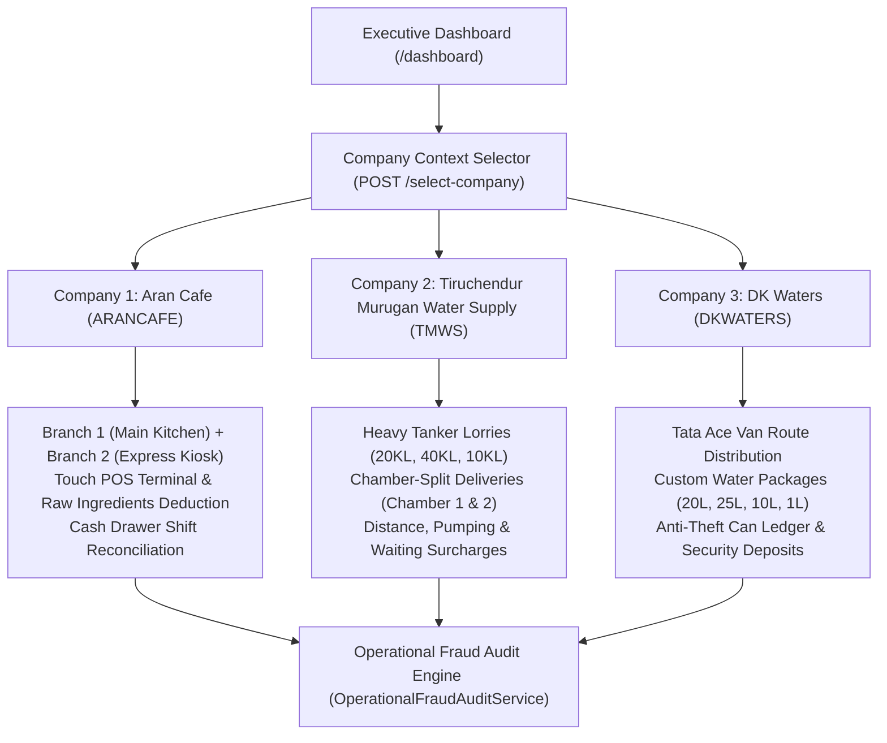

# Procedural Workflow & Operations Manual

**Multi-Enterprise Operations, Financial Integration & Operational Fraud Detection**  
*Document Version:* 1.0.0  
*Applicable Companies:*  
1. **Aran Cafe Private Limited** (`ARANCAFE`) — Multi-Branch Cafe & Bakery  
2. **Tiruchendur Murugan Water Supply** (`TMWS`) — Commercial Bulk Water Tanker Logistics  
3. **DK Waters Private Limited** (`DKWATERS`) — Packaged Drinking Water Route Distribution  

---

## 1. Executive Summary & Enterprise Architecture

This manual establishes the end-to-end Standard Operating Procedures (SOPs), transaction entry flows, double-entry ledger postings, and automated operational fraud detection protocols for the 3 distinct business entities deployed within **zoloERP Pro**.

Each enterprise operates under strict database tenant isolation, independent Chart of Accounts mapping, distinct product catalogs, and dedicated operational modules, unified through the **Multi-Enterprise Command Deck** on the executive dashboard.



---

## 2. Company 1: Aran Cafe (`ARANCAFE`)

### 2.1 Enterprise Profile & Branch Topology
- **Legal Entity:** Aran Cafe Private Limited
- **Vertical Profile:** `cafe_bakery` (`bakery_production`)
- **Branches Configured:**
  1. `MAIN` — *Main Cafe & Kitchen* (Madurai City Center)
  2. `BRANCH-2` — *Express Counter & Takeaway Kiosk* (Bypass Road)
- **Warehouses:**
  - `Aran Cafe - Main` (ID 1)
  - `Aran Cafe - Express Counter` (ID 2)
- **Menu Catalog & Raw Ingredients:**
  - `CF-FILTER`: South Indian Filter Kaapi (Cup) — ₹35.00
  - `CF-TEA`: Masala Chai / Special Tea (Cup) — ₹30.00
  - `BK-CROISSANT`: Butter Flaky Croissant — ₹85.00
  - `BK-BREAD`: Artisan Sourdough Loaf (400g) — ₹120.00
  - `BK-MUFFIN`: Dark Choco Chip Muffin — ₹65.00
  - `ING-MILK`: Fresh Farm Milk (Raw Ingredient) — ₹48.00/L
  - `ING-SUGAR`: Organic Cane Sugar (Raw Ingredient) — ₹42.00/kg

---

### 2.2 Daily Standard Operating Procedure (SOP)

#### Step 1: Morning Cash Float & Shift Opening
1. Cashier logs into ERP counter terminal at `http://dk-track.test/cafe`.
2. Inspect physical register drawer cash and verify morning float (e.g., ₹1,000 in loose denominations).
3. The float is initialized into the active drawer session.

#### Step 2: Kitchen Raw Material Consumption Logging
1. Pastry chef and barista log daily ingredient consumption via `POST /cafe/raw-materials`:
   - Specify `product_id` (`ING-MILK` or `ING-SUGAR`), `warehouse_id`, `opening_stock`, and `consumed_today`.
2. ERP automatically calls `InventoryMovementService::issue`, posting FIFO inventory reduction directly to the warehouse ledger.

#### Step 3: Counter Touch POS Billing
1. Access POS terminal at `http://dk-track.test/cafe/pos` or standard POS at `http://dk-track.test/pos`.
2. Tap items (`CF-FILTER`, `BK-CROISSANT`) to add to customer tray.
3. Accept payment via **Cash** or **UPI / Card**.
4. Print thermal KOT (Kitchen Order Ticket) and customer tax receipt.
5. System records payment into `payments` table and credits Cafe Sales Revenue (`4010`).

#### Step 4: Evening Cash Drawer Reconciliation
1. At shift close, the head cashier opens `Evening Drawer Reconciliation` modal.
2. Enter physical cash counted and UPI bank settlement screenshot total.
3. ERP queries system sales for the shift date:
   $$\text{Total Expected Cash} = \text{Opening Float} + \text{System Cash Sales}$$
   $$\text{Cash Discrepancy} = \text{Physical Cash Counted} - \text{Total Expected Cash}$$
4. If discrepancy is within $\pm ₹10.00$, status is marked `balanced`. If negative, marked `short` and flagged for manager sign-off.

---

### 2.3 Operational Fraud Detection & Risk Controls (Aran Cafe)

| Fraud Vector | Attack Scenario | Detection Algorithm | System Response |
| :--- | :--- | :--- | :--- |
| **Cash Skimming** | Cashier pockets cash from untracked cash sales, submitting ₹4,200 when system recorded ₹5,000 cash sales. | `auditCashDrawer()` compares physical cash against $\text{Opening Float} + \text{System Cash Sales}$. | Discrepancy of -₹800 calculated, status set to `short`, `POTENTIAL_CASH_SKIMMING` alert logged, drawer lock enforced until manager review. |
| **Phantom Wastage Write-Off** | Chef claims 25 Litres of Milk was "spoiled" to cover up taking milk home, while sales only justified 10 Litres. | `auditIngredientConsumption()` compares reported usage against theoretical recipe yield with a 15% tolerance threshold. | Discrepancy flagged as `PHANTOM_WASTAGE_DETECTED`. Requests exceeding available stock are rejected as `IMPOSSIBLE_CONSUMPTION`. |
| **Cross-Branch Stock Hijacking** | Kiosk cashier attempts to bill items using stock allocated to Main Kitchen warehouse. | Multi-branch tenant isolation filter enforces `warehouse.branch_id == user.current_branch_id`. | Transaction blocked with branch boundary violation error. |

---

## 3. Company 2: Tiruchendur Murugan Water Supply (`TMWS`)

### 3.1 Enterprise Profile & Tanker Fleet Specifications
- **Legal Entity:** Tiruchendur Murugan Water Supply
- **Vertical Profile:** `bulk_water` (`commercial_tankers`)
- **Fleet Roster:**
  1. `TN-58-BW-2001`: 20KL Heavy Tanker — *Dual Compartments (10KL + 10KL)*
  2. `TN-58-BW-4001`: 40KL Tri-Chamber Tanker — *3 Compartments (10KL + 10KL + 20KL)*
  3. `TN-58-BW-1001`: 10KL Single Tanker — *Single Compartment (10KL)*
- **Rate Matrix:**
  - Base Delivery: ₹2,400 (10KL), ₹3,800 (20KL), ₹5,500 (40KL) including 10 KM free distance.
  - Excess Mileage (`SRV-KM`): ₹45.00 / KM beyond base 10 KM limit.
  - Motor Pumping (`SRV-PUMP`): ₹10.00 / minute of unloading operation.
  - Site Waiting Delay (`SRV-WAIT`): ₹15.00 / minute of customer premises detention.

---

### 3.2 Daily Standard Operating Procedure (SOP)

#### Step 1: Tanker Inspection & Loading at Borewell Plant
1. Tanker arrives at Nilakottai Borewell Filtration Plant.
2. Operator logs departure odometer reading and inspects chambers.
3. Loading valves filled to calibrated capacity (e.g., 20KL loaded into Chamber 1 [10KL] + Chamber 2 [10KL]).

#### Step 2: Multi-Customer Chamber-Split Delivery Dispatch
1. Open Sales Workspace at `http://dk-track.test/sales?new=1` or Water Logistics at `http://dk-track.test/water-logistics`.
2. Click **Tanker Trip Sheet Calculator** (`#tanker-trip-calc-modal`):
   - Select Tanker: `TN-58-BW-2001` (20KL).
   - Compartment selection:
     - Drop 1: Customer A (Meenakshi Hospital) — Chamber 1 (10KL).
     - Drop 2: Customer B (Heritage Madurai) — Chamber 2 (10KL).
3. The system calculates and displays: *Approx Remaining Water in Tank: 10KL after Drop 1; 0KL after Drop 2*.

#### Step 3: Unloading, Surcharges & Customer Sign-Off
1. Driver unloads via motorized centrifugal pump. Unloading time logged (e.g., 30 minutes).
2. Site waiting delay recorded (e.g., 20 minutes delay waiting for security gate access).
3. Site engineer signs digital receipt on driver mobile terminal or physical DC.

#### Step 4: Invoicing & Automatic Financial Ledger Posting
The invoice registers itemized bill lines without layout disturbance:
$$\text{Net Total} = \text{Base Rate} + (\text{Excess KM} \times ₹45) + (\text{Pump Mins} \times ₹10) + (\text{Wait Mins} \times ₹15)$$

Upon save, ERP automatically posts balanced double-entry journals:
- **Debit:** Accounts Receivable (`1030`) — Full invoice amount.
- **Credit:** Bulk Water Logistics Revenue (`4010`) — Delivery services.
- **Debit:** Tanker Diesel & Driver Batta Expense (`5020`) — Operating expenses.
- **Credit:** Cash in Hand / Petty Cash (`1010`) — Disbursed expenses.

---

### 3.3 Operational Fraud Detection & Risk Controls (TMWS)

| Fraud Vector | Attack Scenario | Detection Algorithm | System Response |
| :--- | :--- | :--- | :--- |
| **Odometer Rollback** | Driver tampers with or rolls back odometer to conceal unauthorized personal haulage. | `auditTankerOdometer()` asserts $\text{End KM} \ge \text{Start KM}$. | Immediate `ODOMETER_ROLLBACK_DETECTED` critical security exception; voucher blocked. |
| **Inflated Mileage Fraud** | Driver claims 110 KM travel for extra excess mileage pay, but actual GPS telematics route was only 32 KM. | `auditTankerOdometer()` cross-checks claimed mileage against live GPS telematics ping distance with a 5 KM tolerance. | Mileage inflation exceeding tolerance is flagged as `INFLATED_MILEAGE_FRAUD`; excess mileage reduced to GPS verified distance. |
| **Water Siphoning / Black Market Theft** | Tanker leaves plant with 20KL; customer voucher signed for 14KL; driver returns empty with 0KL (6KL siphoned off for cash). | `auditWaterDecanting()` calculates $\text{Unaccounted Loss} = \text{Loaded KL} - (\text{Delivered KL} + \text{Returned KL})$. | Volume loss $> 0.3\text{ KL}$ is flagged as `WATER_THEFT_DETECTED` with critical risk; financial liability charged to driver ledger. |
| **Inflated Pumping Surcharge** | Driver bills 180 minutes of motor pumping (₹1,800) for a 10KL delivery that physically takes 25-30 minutes. | `auditSurchargePumping()` limits pumping time to $\text{Delivered KL} \times 5.0\text{ mins/KL}$. | Claim exceeding 50 minutes flagged as `INFLATED_PUMPING_SURCHARGE`; surcharge clamped to standard allowable maximum. |

---

## 4. Company 3: DK Waters (`DKWATERS`)

### 4.1 Enterprise Profile & Route Fleet Specifications
- **Legal Entity:** DK Waters Private Limited
- **Vertical Profile:** `packaged_water` (`can_route_distribution`)
- **Fleet Roster:**
  - Route 1: *Anna Nagar & Teppakulam Route* (Vehicle `TN-58-WA-101`, Tata Ace, Driver R. Muthu)
  - Route 2: *KK Nagar & Mattuthavani Route* (Vehicle `TN-58-WA-102`, Tata Ace, Driver P. Selvam)
- **Customizable Packaging Catalog:**
  - `CAN-20L`: 20L Standard Packaged Drinking Water Can — ₹40.00
  - `CAN-25L`: 25L Industrial Water Can — ₹55.00
  - `CAN-10L`: 10L Easy-Dispense Water Can — ₹30.00
  - `BTL-1L`: 1 Litre Mineral Water Bottle (Carton of 12) — ₹180.00
  - `BTL-2L`: 2 Litre Mineral Water Bottle (Carton of 9) — ₹220.00
  - `BTL-500ML`: 500ml Mineral Water Bottle (Carton of 24) — ₹240.00
  - `CAN-DEP`: 20L Empty Can Security Deposit (Refundable) — ₹150.00

---

### 4.2 Daily Standard Operating Procedure (SOP)

#### Step 1: Morning Van Loading & Stock Dispatch
1. Driver arrives at yard at 07:30 AM.
2. Warehouse manager loads 80 filled 20L cans onto Tata Ace vehicle.
3. Loading sheet registered under Route 1 (`morning_loaded_cans = 80`).

#### Step 2: Route Customer Deliveries & Empty Bottle Exchange
1. Driver stops at customer premises (offices, apartments, clinics).
2. For each delivery:
   - Record `cans_delivered` (e.g., 5 cans).
   - Record `empty_cans_returned` (e.g., 4 empties returned).
3. The customer live bottle balance is updated in real time:
   $$\text{New Cans Held} = \text{Previous Held} + \text{Cans Delivered} - \text{Empty Cans Returned}$$
4. If customer is new or increasing their bottle count, collect Security Deposit (`CAN-DEP` @ ₹150.00/can).

#### Step 3: Evening Van Route Audit & Empty Can Recovery
1. Van returns to yard at 05:30 PM.
2. Yard supervisor physically inspects:
   - Number of remaining filled cans (e.g., 8 filled cans).
   - Number of collected empty cans (e.g., 68 empty cans).
   - Number of damaged/cracked cans (e.g., 0 cans).
3. System verifies bottle conservation:
   $$\text{Accounted Cans} = \text{Delivered Cans} + \text{Returned Filled Cans}$$
   $$\text{Missing Shortage} = \text{Morning Loaded} - \text{Accounted Cans}$$

#### Step 4: Corporate B2B 15/30-Day Credit Aging
1. Corporate clients billed on monthly cycle.
2. Credit manager inspects **Credit Aging Board** at `http://dk-track.test/water-logistics/credit-aging`:
   - Categorized into `0-30 Days`, `31-60 Days`, and `60+ Days (Overdue)`.
   - Automated WhatsApp payment reminders dispatched for overdue accounts.

---

### 4.3 Operational Fraud Detection & Risk Controls (DK Waters)

| Fraud Vector | Attack Scenario | Detection Algorithm | System Response |
| :--- | :--- | :--- | :--- |
| **Driver Can Shortage & Siphoning** | Driver takes 80 cans, delivers 65, returns with only 5 filled cans and claims 10 were "lost" (reselling plastic cans on the street for ₹100 cash each). | `auditRouteCanBalance()` checks $\text{Morning Loaded} - (\text{Delivered} + \text{Returned Filled})$. | Missing 10 cans flagged as `MISSING_FILLED_CANS` critical fraud; ₹1,500 recovery debit deducted from driver payroll. |
| **Phantom Deposit Refund Fraud** | Customer or driver requests cash refund for 15 empty cans (₹2,250), but ERP ledger shows customer only holds 4 cans. | `auditDepositRefundEligibility()` validates $\text{Requested Refund} \le \text{Customer Held Cans}$. | Refund capped to 4 authorized cans (₹600); excess 11 cans blocked with `PHANTOM_DEPOSIT_REFUND_FRAUD` critical alert. |
| **Unrecorded Refill Swapping** | Driver exchanges customer empties for refills without issuing ERP receipt, pocketing customer cash. | Evening van count discrepancy between physical inventory return and total logged delivery vouchers triggers alert. | Unreconciled van variance prevents route closure. |

---

## 5. Multi-Enterprise Command Deck & Executive UI

The executive dashboard (`http://dk-track.test/dashboard`) presents a cohesive command deck displaying all 3 enterprises side by side:

### Visual Feature Matrix

| Enterprise Card | Visual Theme | Metrics Displayed | Graphical Progress & Visual Meters | Quick Actions |
| :--- | :--- | :--- | :--- | :--- |
| **Aran Cafe** | Amber Palette | Outlets (2 Branches), Daily Sales, Open Drawers, Catalog Items | **2-Branch Kitchen Stock Allocation** comparative horizontal fill bar (Main: 750 vs Express: 635) | POS Counter, Cafe Shift, Active Status Indicator |
| **Tiruchendur Murugan Water Supply** | Deep Blue Palette | Tanker Fleet (3 Lorries / 70KL), Delivered Water, Excess Mileage, Motor Pumping | **Multi-Compartment Chamber Segments** interactive layout (Chamber 1 10KL, Chamber 2 10KL, Chamber 3 20KL) | Tanker Trips, Fleet GPS, Switch Company |
| **DK Waters** | Emerald Palette | Route Fleet (2 Tata Ace beats), Delivered Today, Market Circulation, Deposit Ledger | **Empty Can Recovery & Anti-Theft Ledger** visual recovery track (92% recovery rate with red deficit marker) | Can Routes, Credit Aging, Switch Company |

### One-Click Workspace Switching
Clicking the **Switch** button on any inactive company card dispatches `POST /select-company` with `company_id`. The backend `CompanySelectorController::choose` cleanly resolves the company, branch, and open financial year in session, refreshing the dashboard instantly into the targeted enterprise context.

---

## 6. Automated Test Suite Verification

The complete workflow and fraud detection protocols are validated by an automated PHPUnit Feature Test Suite:
`tests/Feature/ThreeCompaniesWorkflowAndFraudTest.php`

### Test Execution Command
```powershell
php artisan test tests/Feature/ThreeCompaniesWorkflowAndFraudTest.php
```

### Verified Test Scenarios (12 Tests, 87 Assertions — 100% Green)
1. `test_multi_company_isolation_and_distinct_entities`: Verifies 3 companies, 2 branches for Aran Cafe, fleet tankers for TMWS, van beats for DK Waters, and zero catalog leakage.
2. `test_aran_cafe_branch_isolation_and_order_flow`: Verifies Main vs Express warehouse stock isolation during counter sales.
3. `test_aran_cafe_fraud_cash_skimming_detected_on_drawer_closing`: Verifies `auditCashDrawer()` catches missing cash and marks drawer `short`.
4. `test_aran_cafe_fraud_phantom_kitchen_wastage_writeoff_blocked`: Verifies `auditIngredientConsumption()` blocks impossible consumption and flags recipe variances.
5. `test_tmws_tanker_chamber_split_delivery_and_surcharges`: Verifies 20KL dual chamber split delivery calculation and surcharges.
6. `test_tmws_fraud_odometer_tampering_and_inflated_mileage_detected`: Verifies `auditTankerOdometer()` catches meter rollbacks and GPS telematics discrepancies.
7. `test_tmws_fraud_water_theft_unauthorized_decanting_detected`: Verifies `auditWaterDecanting()` detects unaccounted volume loss.
8. `test_tmws_fraud_inflated_motor_pumping_surcharge_detected`: Verifies `auditSurchargePumping()` limits pumping claims to physical pumping rates.
9. `test_dk_waters_packaged_can_and_bottle_distribution_flow`: Verifies customer held can balance ledger and deposit accounting.
10. `test_dk_waters_fraud_driver_missing_can_siphoning_detected`: Verifies `auditRouteCanBalance()` detects missing van filled cans.
11. `test_dk_waters_fraud_phantom_deposit_refund_blocked`: Verifies `auditDepositRefundEligibility()` prevents refunding more cans than customer holds.
12. `test_dashboard_displays_all_three_company_insight_cards`: Verifies executive dashboard renders HTTP 200 with all 3 enterprise cards, graphical meters, and live metrics.
