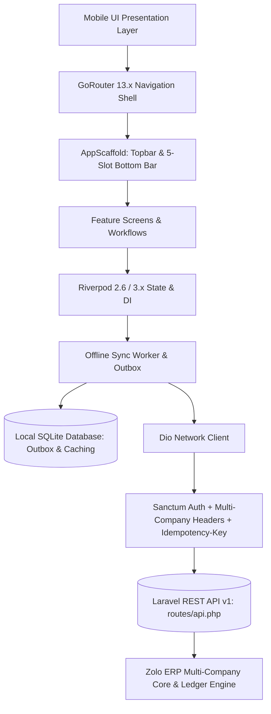

# ZOLO ERP Mobile Application — Complete Architecture & Design Specification

## 1. System Overview & Architecture

The ZOLO ERP Mobile Application (`mobile/`) is an enterprise-grade, offline-first mobile client for the Zolo ERP platform. It is engineered with Flutter / Dart and built on the official Flutter AI Engineering standards (`zakariaf/Flutter-Skills` and `docs.flutter.dev/ai/tools`).



---

## 2. Layered Directory & Module Organization

The codebase follows the strict **feature-first** layered architecture:

```
mobile/lib/
├── core/
│   ├── network/
│   │   ├── api_endpoints.dart         # Centralized REST endpoint catalog
│   │   ├── api_client.dart            # Dio HTTP engine with Sanctum & tenant interceptors
│   │   └── api_result.dart            # Sealed typed ApiResult<T> with NetworkFailure
│   ├── storage/
│   │   ├── secure_storage_service.dart # FlutterSecureStorage for auth tokens & session context
│   │   └── local_database.dart        # SQLite engine (outbox_mutations & cached_records)
│   ├── sync/
│   │   └── sync_worker.dart           # Reactive outbox drain engine with exponential retry
│   ├── theme/
│   │   ├── app_colors.dart            # High-contrast industrial design palette (WCAG AAA)
│   │   ├── app_typography.dart        # Typography scale (min 12sp, tabular figures)
│   │   └── app_theme.dart             # Material 3 light/dark themes (zero blur/frosted glass)
│   ├── routing/
│   │   └── app_router.dart            # GoRouter with authentication redirect guards
│   ├── ui/
│   │   ├── app_scaffold.dart          # Persistent shell with tenant chip, search, sync dot
│   │   ├── kpi_card.dart              # Metric cards with 1px borders
│   │   ├── module_tile.dart           # Categorized launcher tiles
│   │   ├── status_chip.dart           # Triple-encoded status pills (icon + text + color)
│   │   ├── amount_text.dart           # Indian currency formatter (₹1,48,500.00)
│   │   ├── quick_action_sheet.dart    # Modal action sheet for + New button
│   │   ├── company_switcher_sheet.dart# Dynamic multi-tenant organization selector
│   │   ├── empty_state.dart           # Standard empty state illustration & retry
│   │   └── error_state.dart           # Standard error state with recovery action
│   ├── providers.dart                 # Riverpod dependency injection root
│   └── l10n/                          # ARB Localization (English & Tamil)
└── features/
    ├── auth/                          # Authentication, login & identity
    ├── dashboard/                     # Executive multi-entity KPI dashboard
    ├── tasks/                         # Work queue: route stops, approvals, sync outbox
    ├── modules/                       # Searchable categorized 9-domain module launcher
    ├── profile/                       # Active tenant info, sync centre, language, logout
    ├── sales/                         # Invoices list & 4-tap sales bill creation
    ├── purchases/                     # Inward vendor bills & payable dues
    ├── inventory/                     # Warehouse stock valuation & physical count audit
    ├── accounting/                    # Cash book (1010), bank book (1020), collections
    ├── expenses/                      # 20-second quick expense capture with GPS & camera
    ├── hrm/                           # Geofenced check-in & check-out
    ├── reports/                       # Sales revenue, stock valuation, ledger statements
    └── operations/                    # Field vertical workflows:
        ├── can_sales_screen.dart      # 15-second driver can delivery ticket
        ├── plant_refill_screen.dart   # Factory empty handover & full sealed load
        ├── tanker_trip_screen.dart    # Odometer mileage, pumping & waiting surcharges
        ├── spot_audit_screen.dart     # Physical customer jar audit & shortage detection
        ├── driver_surrender_screen.dart# Route cash surrender & general ledger posting
        └── cafe_pos_screen.dart       # Touch POS terminal & cash drawer closing
```

---

## 3. Industrial Design System (Non-Negotiables Met)

1. **Zero Glassmorphism / Frosted Glass:**
   - 100% elimination of `BackdropFilter` and `GlassCard`.
   - Flat, durable surfaces with clean 1px borders (`#E2E8F0` light, `#1F2937` dark).
   - High contrast (>4.5:1 for indoor, >7:1 for outdoor field use).
2. **Typography Scale:**
   - Strict floor: zero text under 12sp.
   - Tabular monospace numbers for all currencies and odometer readings (`JetBrains Mono`).
   - Dynamic scaling up to 1.3x font scale without UI overflow.
3. **Touch Targets & Geometry:**
   - Minimum 48dp touch targets on all interactive controls.
   - Primary action buttons 52dp–56dp height located in the thumb zone.
4. **Bilingual Localization:**
   - Complete `app_en.arb` and `app_ta.arb` files. Zero hardcoded inline `isTamil ?` ternaries.

---

## 4. Security & Offline Sync Engine

1. **Sanctum Authentication:**
   - Real passwords checked against `users` table via `Hash::check()`.
   - Real Sanctum bearer tokens issued per device and stored in `FlutterSecureStorage`.
   - Complete elimination of default passwords, role-switch backdoors, and demo ribbons.
2. **Multi-Company Gating:**
   - Active company, branch, and financial year sent via `X-Company-ID`, `X-Branch-ID`, `X-Financial-Year-ID`.
   - Dynamic gating ensures field drivers, tanker drivers, and cafe cashiers see only their respective vertical workflows.
3. **Offline SQLite Outbox Engine:**
   - Mutations queued in `outbox_mutations` table with client timestamp, GPS coordinates, and UUID `Idempotency-Key`.
   - Automatic background worker drains outbox upon network restoration.
   - Zero silent fake data: cached data explicitly displays `Cached Snapshot` with last refreshed timestamp.

